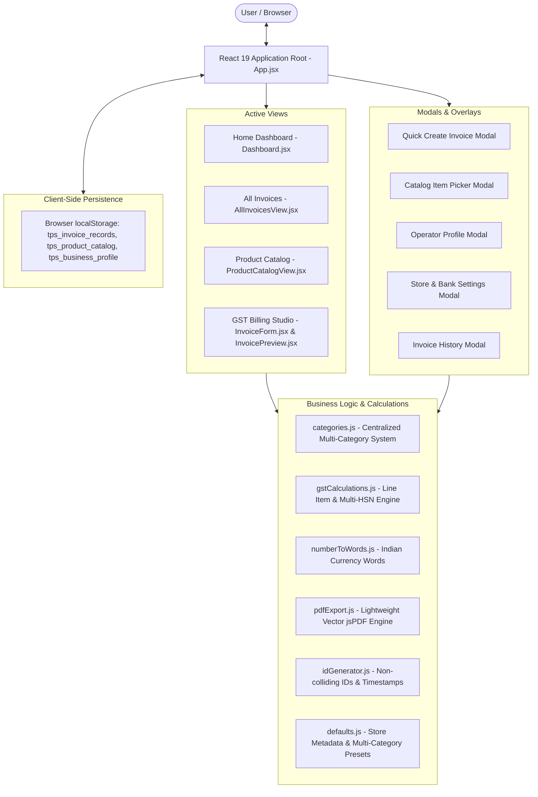
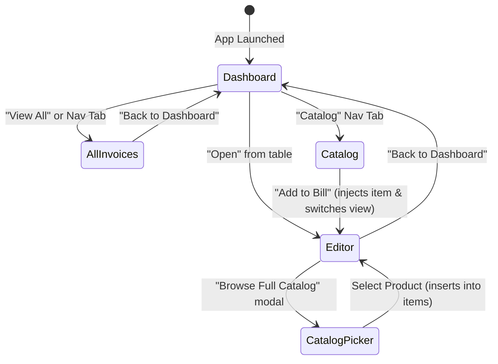
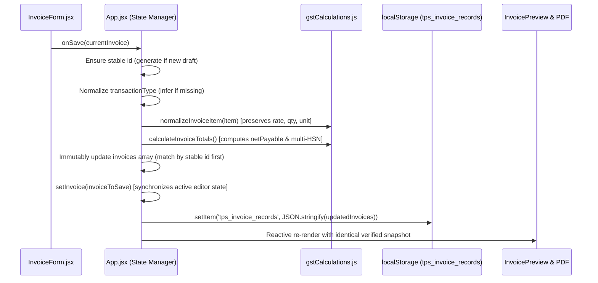

# Multi-Category System Architecture — TPS BATTERYS HOUSE

This document details the multi-category software architecture, data models, component relationships, state ownership, and schema normalization of the **TPS BATTERYS HOUSE** Invoice Management Application.

---

## 1. High-Level Architecture

The application is structured as a client-side Single Page Application (SPA) built on React 19 and Vite. State is managed reactively through React hooks (`useState`, `useEffect`, `useMemo`) and persisted synchronously in browser `localStorage`.



---

## 2. Centralized Product Category System (`src/utils/categories.js`)

The application decouples product-specific assumptions from the core billing and invoicing engine by defining a centralized category configuration registry:

| Category ID | Display Label | Subcategories Supported | Default HSN/SAC | Default GST | Technical Specification Fields |
| :--- | :--- | :--- | :--- | :--- | :--- |
| `battery` | Battery | Automotive, Inverter, Tubular, SMF, VRLA, Lithium, Solar, Two-Wheeler | `8507` | 28% | Capacity (`Ah`), Voltage (`12V/24V`), Technology (`Tall Tubular`, `SMF`, etc.), Warranty, Serial Number |
| `inverter` | Inverter | Home Inverter, Commercial, Solar Inverter, Hybrid, Off-Grid, On-Grid, UPS | `8504` | 18% | Capacity (`VA/kVA`), Power (`Watts/kW`), Waveform (`Pure Sine Wave`), Voltage, Warranty, Serial Number |
| `solar` | Solar | Solar Panels (Mono/Bifacial/TopCon), Inverters, MPPT Controllers, Solar Batteries, Cables, Systems | `8541` | 12% / 18% | Rated Capacity (`Wp`), Panel Technology, System Capacity (`kW`), Warranty, Serial Number |
| `services` | Services | Solar Installation, Inverter Setup, Battery Installation, AMC, Maintenance, Repair | `9954` / `9987` | 18% | Service Category, Scope of Work, Turnaround/Warranty (physical fields suppressed) |

---

## 3. Generalization of Invoice Line Items

A shared, universal line item structure represents any product or service without forcing inappropriate physical attributes:

```typescript
interface InvoiceLineItem {
  id: string;
  name: string;
  category: 'battery' | 'inverter' | 'solar' | 'services';
  subcategory?: string;
  brand?: string;
  model?: string;
  specs: {
    // Dynamic category-specific key/values
    capacity?: string;
    voltage?: string;
    batteryType?: string;
    capacityVa?: string;
    powerWatts?: string;
    waveform?: string;
    ratedCapacityWp?: string;
    panelTechnology?: string;
    systemCapacityKw?: string;
    serviceScope?: string;
    [key: string]: string | undefined;
  };
  hsn: string;
  serialNo?: string;
  warranty?: string;
  qty: number;
  unit: 'Nos' | 'Set' | 'Piece' | 'Watt' | 'kW' | 'Meter' | 'Job' | 'Service';
  rate: number;
  isTaxInclusive: boolean;
  gstRate: number;
}
```

### Mixed-Category Invoices
A single invoice can simultaneously contain a tubular battery (`8507`, 28%), a home inverter (`8504`, 18%), bifacial solar panels (`8541`, 12%), and a rooftop installation service (`9954`, 18%).
- Each line item computes its own taxable value, CGST/SGST/IGST, and line total independently.
- The invoice computes a multi-HSN statutory summary table grouping entries by `${item.hsn}_${item.gstRate}`.
- Category sales breakdown (`categorySales`) sums item line totals without double counting.

---

## 4. Navigation & State Lifecycle

The application router in [`src/App.jsx`](../src/App.jsx) manages four main views:
1. `'dashboard'`: Business summary KPIs, 4 category sales performance bars, category-filtered invoice list.
2. `'invoices'`: Comprehensive table/card view with sorting, category filters, and search.
3. `'catalog'`: Full Product Catalog manager with CRUD modal, search, brand filters, and "Add to Bill".
4. `'editor'`: Dual-pane GST Tax Bill Generator and Live A4 Invoice Preview.



---

## 5. Save Workflow, Data Integrity & State Synchronization

The application enforces a deterministic, immutable save pipeline between the editor, state manager, and client storage:



### Key Integrity Safeguards:
1. **Active Editor Synchronization:** Calling `setInvoice(invoiceToSave)` immediately upon saving guarantees the editor and the persisted record remain in identical sync, preventing stale state overwrites.
2. **Stable Draft IDs:** Every newly initiated invoice receives a collision-proof ID (`inv-${Date.now()}-${random}`) at creation time, preventing ID-less drafts from breaking invoice update lookups.
3. **Immutable Price Preservation:** The operator's entered unit rate is protected from repeated tax deductions, and decimal prices (`parseFloat`) are preserved without integer truncation.
4. **Non-Destructive Phone Numbers:** Phone strings preserve country codes and spacing via `replace(/[^\d+ -]/g, '')`.

---

## 6. A4 Page Geometry & Dynamic Bottom Anchoring Architecture

The invoice layout in [`src/components/InvoicePreview.jsx`](../src/components/InvoicePreview.jsx) and the vector PDF engine in [`src/utils/pdfExport.js`](../src/utils/pdfExport.js) follow a traditional Indian retail GST accounting document structure adhering strictly to A4 portrait specifications:

- **Page Dimensions:** 210 mm (width) × 297 mm (height), portrait orientation.
- **Vertical Layout Budget:**
  - Target bottom margin: `284 mm` (leaving a 13 mm print-safe bottom clearance).
  - Reserved height for lower summary sections: Subtotal row (5.5 mm) + Section E (Amount in Words, GST Summary, boxed Bill Amount, Bank Details: 44 mm) + Footers (Terms, UPI QR, Signatory: 32 mm) = **81.5 mm**.
  - Target Subtotal start position: $284\text{ mm} - 81.5\text{ mm} = \mathbf{202.5\text{ mm}}$.
- **Dynamic Single-Page Anchoring:**
  - When an invoice has few line items (1 to 5), the product table vertical lines extend dynamically from the end of the last item row down to `202.5 mm`.
  - This positions the Subtotal row at `202.5 mm`, Section E from `208 mm` to `252 mm`, and the Footer Grid from `252 mm` to `284 mm`.
  - Eliminates awkward floating summaries and prevents large empty whitespace in the bottom third of the invoice.
- **Multi-Page Handling:**
  - When items exceed `202.5 mm`, the engine completes the table on continuation pages with repeating column headers (`Sl`, `HSN Code`, `Item Name`, `Qty`, `Price`, `Dis Amt`, `GrossAmt`, `GST %`, `GST Amt`, `Total`) and proper pagination (`Page p of totalPages`).
  - The final summary and signature block always sit cleanly at the bottom of the final page.
- **Section Structure:**
  - **Section A (Seller Header & Top Bar):** Business PAN (`PAN NO : DIUPP1211B`), `TAX INVOICE (B2B)` / `TAX INVOICE (B2C)`, Copy Title (`Original for Buyer`), TPS BATTERYS HOUSE branding, Padinarangadi address, contact numbers, GSTIN, and State Code `32`.
  - **Section B (Buyer, Consignee & Invoice Details Grid):** Three enclosed columns: `Bill To` (Buyer address, GSTIN, PAN), `Shipped To` (Consignee delivery address), and structured metadata table (`Invoice Date`, `Invoice No`, `Payment Mode`, `Place of Supply`, `EWay Bill No`, `IRN No`).
  - **Section C (Main Product Table):** Traditional 10-column table with thin borders: `Sl`, `HSN Code`, `Item Name` (with dynamic category specs, S/N, warranty), `Quantity`, `Price` (pre-tax unit price), `Dis Amt` (`0.00`), `GrossAmt` (taxable amount), `GST` (`%` and `Amt`), and `Total`.
  - **Section D (Item Subtotal):** Subtotal row aggregating quantity, taxable gross amount, total GST, and final line totals.
  - **Section E (Amount in Words, GST Summary & Totals / Bank):**
    - Left column: `Rupees [Amount in Words] Only` and statutory multi-HSN GST computation table (`Taxable Value`, `CGST Rate/Amt`, `SGST Rate/Amt` or `IGST Rate/Amt`, `Total Tax`).
    - Right column: Deductions (Old Battery Scrap Buyback, Special Discount), `Round Off`, bold boxed `Bill Amount`, and Bank details (`Bank Name`, `Account No`, `IFSC Code`, `Branch`).
  - **Section G & H (Footer Grid):**
    - Left: `TERMS & CONDITIONS OF SALE` and operator generation timestamp.
    - Middle: Scannable high-resolution UPI QR Code (`Scan to Pay`).
    - Right: `For TPS BATTERYS HOUSE` with space for physical stamp and `Authorised Signatory`.
- **Vector PDF Engine:** Native vector lines and selectable text in jsPDF (~80-96 KB) matching the browser preview exactly.

