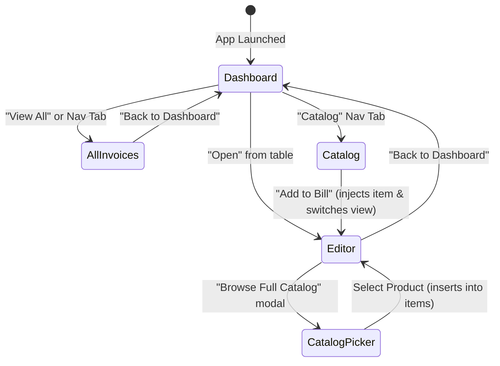

# Multi-Category System Architecture — TPS BATTERYS HOUSE

This document details the multi-category software architecture, data models, component relationships, state ownership, and schema normalization of the **TPS BATTERYS HOUSE** Invoice Management Application.

---

## 1. High-Level Architecture

The application is structured as a client-side Single Page Application (SPA) built on React 19 and Vite. State is managed reactively through React hooks (`useState`, `useEffect`, `useMemo`) and persisted synchronously in browser `localStorage`.


---

## 2. Centralized Product Category System (`src/utils/categories.js`)

The application decouples product-specific assumptions from the core billing and invoicing engine by defining a centralized category configuration registry:

| Category ID | Display Label | Subcategories Supported | Default HSN/SAC | Default GST | Technical Specification Fields |
| :--- | :--- | :--- | :--- | :--- | :--- |
| `battery` | Battery | Automotive, Inverter, Tubular, SMF, VRLA, Lithium, Solar, Two-Wheeler | `8507` | 28% | Capacity (`Ah`), Voltage (`12V/24V`), Technology (`Tall Tubular`, `SMF`, etc.), Warranty, Serial Number |
| `inverter` | Inverter | Home Inverter, Commercial, Solar Inverter, Hybrid, Off-Grid, On-Grid, UPS | `8504` | 18% | Capacity (`VA/kVA`), Power (`Watts/kW`), Waveform (`Pure Sine Wave`), Voltage, Warranty, Serial Number |
| `solar` | Solar | Solar Panels (Mono/Bifacial/TopCon), Inverters, MPPT Controllers, Solar Batteries, Cables, Systems | `8541` | 12% / 18% | Rated Capacity (`Wp`), Panel Technology, System Capacity (`kW`), Warranty, Serial Number |
| `services` | Services | Solar Installation, Inverter Setup, Battery Installation, AMC, Maintenance, Repair | `9954` / `9987` | 18% | Service Category, Scope of Work, Turnaround/Warranty (physical fields suppressed) |

---

## 3. Generalization of Invoice Line Items

A shared, universal line item structure represents any product or service without forcing inappropriate physical attributes:

```typescript
interface InvoiceLineItem {
  id: string;
  name: string;
  category: 'battery' | 'inverter' | 'solar' | 'services';
  subcategory?: string;
  brand?: string;
  model?: string;
  specs: {
    // Dynamic category-specific key/values
    capacity?: string;
    voltage?: string;
    batteryType?: string;
    capacityVa?: string;
    powerWatts?: string;
    waveform?: string;
    ratedCapacityWp?: string;
    panelTechnology?: string;
    systemCapacityKw?: string;
    serviceScope?: string;
    [key: string]: string | undefined;
  };
  hsn: string;
  serialNo?: string;
  warranty?: string;
  qty: number;
  unit: 'Nos' | 'Set' | 'Piece' | 'Watt' | 'kW' | 'Meter' | 'Job' | 'Service';
  rate: number;
  isTaxInclusive: boolean;
  gstRate: number;
}
```

### Mixed-Category Invoices
A single invoice can simultaneously contain a tubular battery (`8507`, 28%), a home inverter (`8504`, 18%), bifacial solar panels (`8541`, 12%), and a rooftop installation service (`9954`, 18%).
- Each line item computes its own taxable value, CGST/SGST/IGST, and line total independently.
- The invoice computes a multi-HSN statutory summary table grouping entries by `${item.hsn}_${item.gstRate}`.
- Category sales breakdown (`categorySales`) sums item line totals without double counting.

---

## 4. Navigation & State Lifecycle

The application router in [`src/App.jsx`](../src/App.jsx) manages four main views:
1. `'dashboard'`: Business summary KPIs, 4 category sales performance bars, category-filtered invoice list.
2. `'invoices'`: Comprehensive table/card view with sorting, category filters, and search.
3. `'catalog'`: Full Product Catalog manager with CRUD modal, search, brand filters, and "Add to Bill".
4. `'editor'`: Dual-pane GST Tax Bill Generator and Live A4 Invoice Preview.



---

## 5. Backward Compatibility & Safe Normalization

Existing invoice records created before the multi-category upgrade lack the `category` field.
The helper `normalizeInvoiceItem(rawItem)` in [`src/utils/categories.js`](../src/utils/categories.js) safely infers the category:
- If `hsn` starts with `99` or name includes `service`/`installation` $\rightarrow$ `services`
- If `hsn` starts with `8541` or name includes `solar`/`panel` $\rightarrow$ `solar`
- If `hsn` starts with `8504` or name includes `inverter`/`ups` $\rightarrow$ `inverter`
- Otherwise default $\rightarrow$ `battery`

This guarantees that:
- Historical invoices open, edit, and export to PDF without errors.
- Stored `localStorage` records are never corrupted or deleted.
