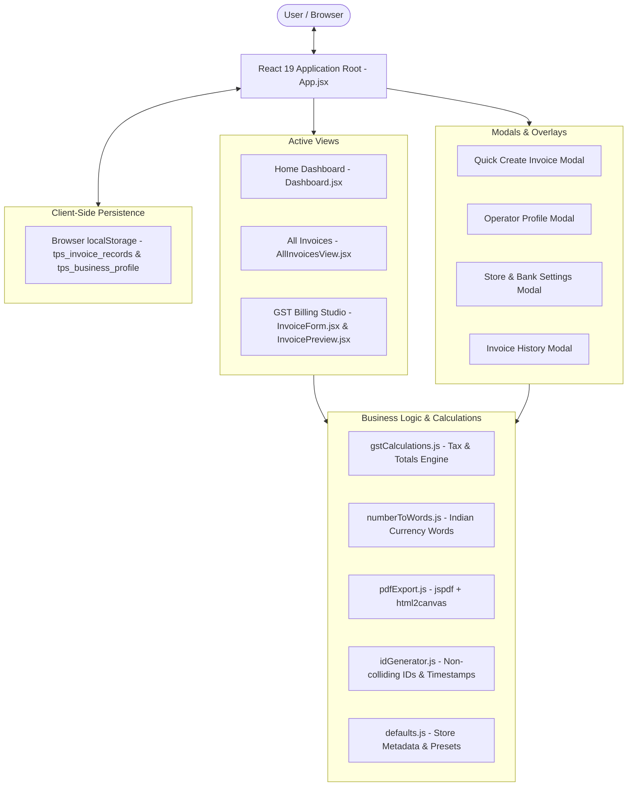
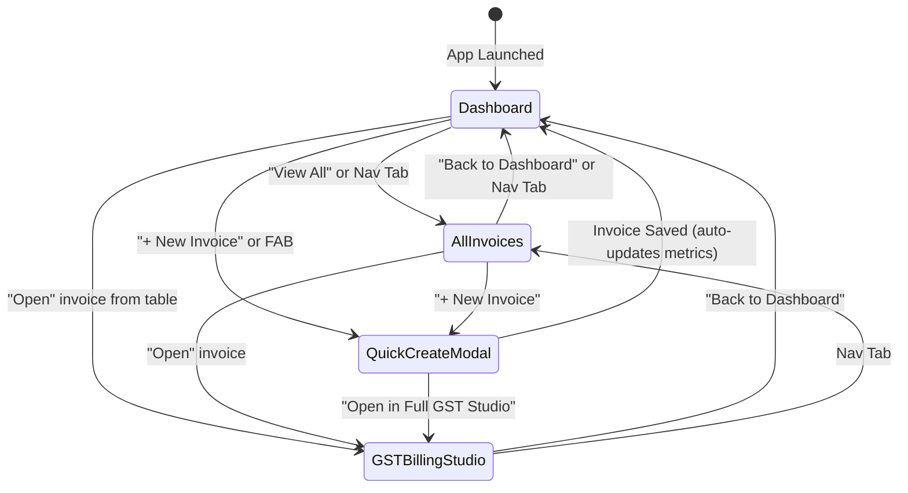
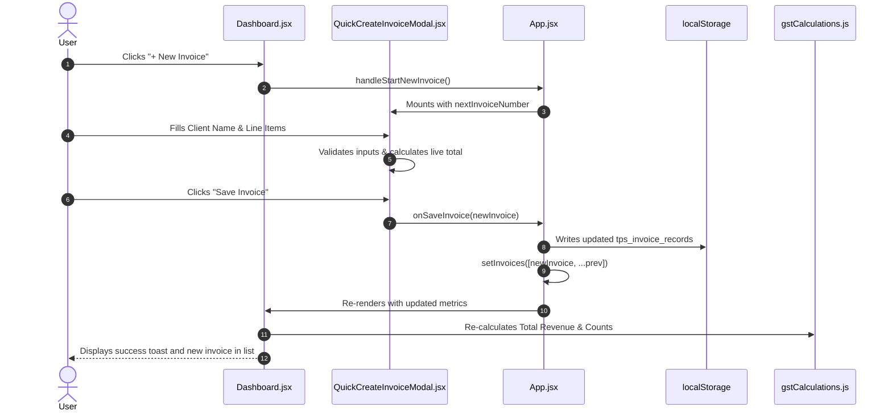

# System Architecture — TPS BATTERYS HOUSE

This document outlines the software architecture, component relationships, state ownership, and data lifecycle of the **TPS BATTERYS HOUSE** Invoice Management Application.

---

## 1. High-Level Architecture

The application is structured as a client-side Single Page Application (SPA) built on React 19 and Vite. State is managed reactively through React hooks (`useState`, `useEffect`, `useMemo`) and persisted synchronously in the browser's `localStorage`.



---

## 2. Navigation & View Routing Model

The application uses an internal state router managed in [`src/App.jsx`](../src/App.jsx) via the `activeView` state:



1. `'dashboard'`: Displays business summary cards, live digital clock, time-based greetings, and recent invoice list.
2. `'invoices'`: Displays a comprehensive, searchable, filterable, and sortable list of all invoice records.
3. `'editor'`: The full dual-panel GST Billing Studio featuring the detailed input form on the left and the live A4 statutory Kerala tax invoice preview on the right.

---

## 3. Component Hierarchy & Responsibilities

```text
src/
├── main.jsx                       # Application bootstrap (createRoot)
└── App.jsx                        # Root Coordinator & State Container
    ├── Header.jsx                 # Top Navbar, Brand, Live Clock, Nav Tabs, Profile Dropdown
    ├── Dashboard.jsx              # Summary Metrics, Time Greeting, Recent Invoices Table/Cards
    ├── AllInvoicesView.jsx        # Full Invoices Table/Cards, Search, Sorters, Deletion
    ├── FloatingActionButton.jsx   # Fixed bottom-right creation trigger (hidden on editor)
    ├── QuickCreateInvoiceModal.jsx# Fast invoice modal with line items & instant validation
    ├── UserProfileModal.jsx       # Operator information & local mock notice
    ├── BusinessSettingsModal.jsx  # Store details, GSTIN, Bank A/C, IFSC, UPI ID editor
    ├── InvoiceHistoryModal.jsx    # Legacy history drawer & record management
    └── [Editor View]
        ├── InvoiceForm.jsx        # Dynamic itemized billing form, HSN chips, scrap exchange
        └── InvoicePreview.jsx     # Statutory Kerala GST Tax Invoice A4 sheet layout
            └── UpiQrCode.jsx      # Dynamic Canvas/SVG UPI payment QR code
```

### Detailed Component Roles

| Component | Responsibility |
| :--- | :--- |
| **`App.jsx`** | Master state owner for `invoices`, `activeView`, and `invoice` (active draft). Handles cross-component event dispatching, toast banners, and `localStorage` persistence. |
| **`Header.jsx`** | Renders brand logo, GSTIN badge, page tabs with invoice count pill, digital clock (1s tick interval), date, and simulated operator dropdown. |
| **`Dashboard.jsx`** | Computes 4 summary metrics (`Total Invoices`, `Paid`, `Pending`, `Total Revenue`), renders search and filter controls, and presents recent invoices. |
| **`AllInvoicesView.jsx`** | Manages the complete invoice dataset with multi-criteria sorting (Newest, Oldest, Amount High/Low) and status filters. |
| **`QuickCreateInvoiceModal.jsx`** | Lightweight modal for rapid invoice generation without navigating away from the dashboard. Enforces field and date validations. |
| **`InvoiceForm.jsx`** | Comprehensive GST form with support for product catalogue presets, HSN code selection, warranty terms, reverse tax-inclusive calculation, and scrap battery exchange deductions. |
| **`InvoicePreview.jsx`** | Pixel-perfect Kerala GST Tax Invoice adhering to A4 dimensions (210mm × 297mm), including statutory declarations, HSN tax summaries, and authorized signatory blocks. |
| **`UpiQrCode.jsx`** | Generates an NPCI-compliant UPI payment intent string (`upi://pay?pa=...`) and renders a sharp QR code via `qrcode`. |

---

## 4. State Ownership and Data Flow

### Invoice Lifecycle Flow



---

## 5. Storage Keys & Migration Strategy

The application standardizes on the following `localStorage` keys:

| Key | Type | Description |
| :--- | :--- | :--- |
| `tps_invoice_records` | JSON Array | Primary collection of all created, edited, and mock invoices. |
| `tps_invoice_draft` | JSON Object | Active working invoice loaded in the full GST Billing Studio. |
| `tps_business_profile` | JSON Object | Store business details (GSTIN, Bank Name, A/C, IFSC, UPI ID). |
| `tps_invoice_history` | JSON Array | Legacy backup store (synced for backwards compatibility). |

### Initialization & Guard Rules
- When the application starts, `tps_invoice_records` is queried.
- **If key is null:** The application seeds the initial diverse mock invoices from [`src/data/mockData.js`](../src/data/mockData.js).
- **If key exists (even if empty `[]`):** The application respects the user's stored dataset and **does not** overwrite it with mock data.
- All JSON parsing operations are wrapped in `try...catch` blocks to protect against corrupted browser storage.
