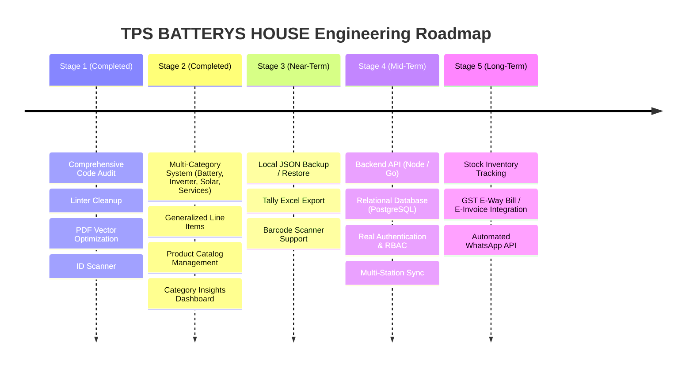

# Engineering Roadmap & Evolution Plan

> **Project Name:** TPS BATTERYS HOUSE — Multi-Category Invoice Management Application  
> **Current Version:** v1.2.0-multicategory (Multi-Category Sales & GST Billing Upgrade)  
> **Target:** Cloud-Enabled Enterprise Invoicing & Battery/Solar Energy Management Platform

---

## 1. Roadmap Overview & Strategic Horizon

This roadmap establishes a practical, phased path from the current standalone client-only application to a multi-branch retail management platform.

---

## 2. Completed Milestones

### Stage 1 — Stabilization & PDF Optimization (Completed)
- [x] **Vector PDF Engine (`pdfExport.js`):** Lightweight vector PDF export reducing file sizes from ~11 MB to **~78 KB** (99.28% reduction) with selectable text and embedded UPI QR code.
- [x] **Defensive Hardening:** Fixed sequential ID collisions, protected currency words against `NaN`, and prevented invalid date sequences.
- [x] **Zero Linter Warnings:** Cleared all warnings in Oxlint.

### Stage 2 — Multi-Category Product & GST Billing Upgrade (Completed)
- [x] **Centralized Category System (`categories.js`):** Support for Battery, Inverter, Solar, and Services categories with subcategories and default HSN/GST configurations.
- [x] **Generalized Invoice Line Items:** Line items support dynamic category-specific specifications (Ah, voltage, VA, Watts, waveform, Wp, technology, service scope) without forcing inappropriate fields onto services.
- [x] **Mixed-Category Invoices:** Single invoice can bill batteries, inverters, solar panels, and installation services together, calculating item-level taxes and multi-HSN summaries correctly.
- [x] **Product Catalog Management (`ProductCatalogView.jsx`):** Standalone catalog view with CRUD operations, category filters, brand filters, live search, and 1-click "Add to Bill".
- [x] **Category Sales Dashboard:** Real-time KPI breakdown (Battery Sales, Inverter Sales, Solar Sales, Service Revenue) without double-counting mixed invoices.
- [x] **Battery-Exclusive Scrap Exchange:** Old battery buyback preserved exclusive to battery transactions with eligibility guidance.
- [x] **Backward Compatibility (`normalizeInvoiceItem`):** Safe normalization of historical invoices in `localStorage` without category fields.

---

## 3. Stage 3 — Backup, Recovery & Offline Utilities (Near-Term Priority)

*Objective: Mitigate single-station data loss risks and streamline daily counter operations before deploying server infrastructure.*

### 3.1 Backup & Disaster Recovery Utility
- **Local JSON Export:** "Backup Database" button that generates a timestamped downloadable file (`tps_backup_YYYYMMDD_HHMM.json`) containing all invoices and catalog items from `localStorage`.
- **JSON Import / Restore:** File upload utility that parses, validates schemas, and restores backups into local storage.
- **CSV / Excel Export:** Quarterly invoice ledgers formatted for Tally or Excel GST filing.

### 3.2 Barcode & Serial Scanner Integration
- USB/Bluetooth barcode scanner support to scan serial numbers directly into the Serial No input during checkout.

---

## 4. Stage 4 — Backend Integration & Authentication (Mid-Term)

*Objective: Transition from browser storage to a central database with authenticated multi-user controls.*

### 4.1 Architecture Transition
- **Backend API:** Fastify / Express or Go service communicating over HTTPS.
- **Database:** PostgreSQL 16 with relational schemas for `stores`, `users`, `products`, `invoices`, and `invoice_items`.
- **Authentication:** JWT with HTTP-only cookies replacing the mock "Alex Johnson" simulation.
- **RBAC Roles:**
  - *Store Owner / Admin:* Full access to configuration, invoice deletion, and financial summaries.
  - *Billing Cashier:* Create and print invoices; restricted from editing store settings or changing tax rules.
  - *Auditor:* Read-only access to tax ledgers and reports.

---

## 5. Stage 5 — Inventory Tracking & Statutory Integrations (Long-Term)

*Objective: Full ERP automation for warehouse and government filing.*

- **Stock / Inventory Management:** Deduct physical stock on invoice creation and alert on low stock levels (strictly kept separate from catalog in Phase 1).
- **GST E-Way Bill & E-Invoice API:** Direct integration with GST NIC API for automated IRN generation and QR code printing on B2B invoices.
- **Automated WhatsApp / SMS Gateway:** Automated dispatch of invoice PDFs to customer mobile numbers via WhatsApp Cloud API.
