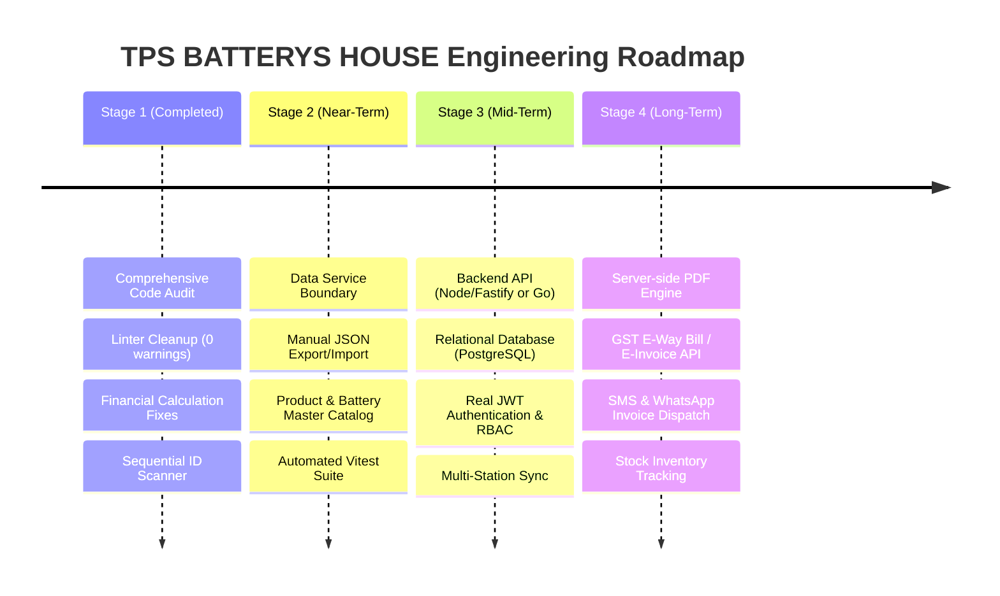
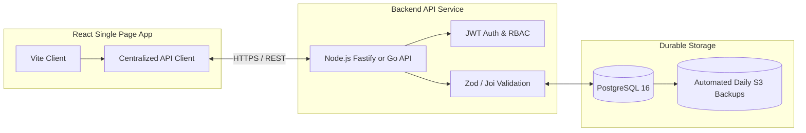

# Engineering Roadmap & Evolution Plan

> **Project Name:** TPS BATTERYS HOUSE — Invoice Management Application  
> **Current Version:** v1.1.0-client (Stabilized Frontend)  
> **Target:** Cloud-Enabled Enterprise Invoicing & Battery Store Management System

---

## 1. Roadmap Overview & Strategic Horizon

This roadmap establishes a practical, phased path from the current standalone client-only application to a secure, resilient, multi-user retail management platform.

---

## 2. Stage 1 — Stabilization & Client Hardening (Completed)

*Objective: Eliminate all client-side runtime crashes, sequence collisions, and mathematical edge cases.*

- [x] **AUD-001 (Sequence Collisions):** Implemented regex-based sequential ID generator (`maxSeq + 1`) to prevent invoice number re-use after record deletion.
- [x] **AUD-002 (Storage Initialization):** Fixed `localStorage` empty array re-seeding bug, ensuring store operators can intentionally clear or start clean datasets.
- [x] **AUD-003 (Numeric State Code):** Added safe string coercion in `gstCalculations.js` to eliminate uncaught `TypeError` exceptions.
- [x] **AUD-004 (Finite Number Formatting):** Protected Indian currency formatters and word converters against `NaN` and `Infinity`.
- [x] **AUD-005 (Defensive Rendering):** Hardened GSTIN PAN slicing and nullable customer address blocks in `InvoicePreview.jsx`.
- [x] **AUD-006 & AUD-007 (Input Bounds):** Enforced positive quantities, non-negative unit prices, non-negative scrap trade-ins, and logical date ordering (`dueDate >= invoiceDate`).
- [x] **AUD-008 & AUD-009 (Code Hygiene):** Cleared 36 linter warnings, removed dead imports, and extracted pure ID and greeting helpers.
- [x] **Documentation Package:** Authored comprehensive architectural, testing, calculation, user, and security documentation in `docs/`.

---

## 3. Stage 2 — Persistence, Recovery & Battery Catalog (Near-Term Priority)

*Objective: Mitigate single-station data loss risks and streamline daily battery billing without requiring immediate cloud infrastructure.*

### 2.1 Backup & Disaster Recovery Utility
- **Local JSON Export:** Add a prominent "Backup Invoices" button that generates a timestamped downloadable file (`tps_backup_YYYYMMDD_HHMM.json`) directly from `localStorage`.
- **JSON Import / Restore:** Provide a secure file upload utility that parses, validates schemas, and merges or restores backup files into local storage with collision detection.
- **CSV / Excel Export:** Allow store accountants to download quarterly invoice ledgers formatted for Tally or Excel GST filing.

### 2.2 Battery Product Master Catalog
- Introduce a persistent SKU/Product catalog storing:
  - Manufacturer (Exide, Amaron, SF Sonic, Tata Green, Luminous)
  - Model Name & Ah Rating (e.g., 35Ah, 45Ah, 100Ah, 150Ah)
  - Standard HSN Code (`85071000` for lead-acid starters)
  - Default GST Rate (28%)
  - Manufacturer Warranty Period (e.g., 24M Full + 24M Pro-rata)
  - Standard Retail Price & Standard Scrap Trade-in Value

### 2.3 Automated Testing Infrastructure
- Install and configure `vitest` with `@testing-library/react`.
- Establish automated unit test suites for:
  - `gstCalculations.test.js` (intra-state, inter-state, scrap deductions, round-off)
  - `idGenerator.test.js` (uniqueness under concurrency)
  - `numberToWords.test.js` (boundary conditions: ₹0, ₹99,99,999)

---

## 4. Stage 3 — Backend Integration, Tenancy & Authentication (Mid-Term)

*Objective: Transition from browser storage to a reliable, multi-station central database with authenticated operator controls.*

### 3.1 Architecture Transition

### 3.2 Authentication & Role-Based Access Control (RBAC)
- Replace mock "Alex Johnson" simulation with real cryptographic authentication (JWT with HTTP-only refresh cookies).
- Define user roles:
  - **Store Owner / Admin:** Full access to business GST settings, invoice deletion, profit summaries, and user management.
  - **Billing Cashier / Operator:** Create and print invoices, view existing invoices, search customer phone numbers; restricted from deleting issued invoices or changing tax rates.
  - **Accountant / Auditor:** Read-only export access to financial reports and tax ledgers.

### 3.3 Database Relational Schema
- Implement normalized PostgreSQL tables:
  - `stores` (business details, GSTIN, addresses, bank details)
  - `users` (credentials, roles, store association)
  - `customers` (phone number, GSTIN, address, state code)
  - `products` (battery brand, capacity, warranty, base price)
  - `invoices` (invoice number, dates, status, taxable amount, tax totals, final amount)
  - `invoice_items` (invoice ID, description, HSN, serial number, rate, quantity, scrap deduction)
  - `audit_logs` (immutable record of all invoice actions)

---

## 5. Stage 4 — Enterprise Production Readiness & Accounting (Long-Term)

*Objective: Full statutory GST compliance, automated customer communication, and hardware POS integrations.*

### 4.1 Server-Side High-Fidelity PDF Generation
- Implement headless Chromium (`puppeteer` or `@react-pdf/renderer`) running on the server to generate standardized, pixel-perfect, downloadable A4 tax invoices without depending on local browser print dialogs.

### 4.2 Customer Digital Dispatch
- **WhatsApp Cloud API Integration:** Send clickable PDF download links and warranty confirmation receipts directly to the customer's mobile number upon invoice creation.
- **SMS Gateway:** Automatic reminder alerts for pending or overdue commercial invoices.

### 4.3 Warranty & Battery Serial Number Tracking
- Add a dedicated Battery Serial Number lookup engine.
- Allow technicians to type or scan a battery barcode to instantly retrieve the original invoice date, customer name, and remaining warranty coverage (free replacement vs. pro-rata discount period).

### 4.4 Statutory GST E-Way Bill Integration
- For commercial battery shipments exceeding ₹50,000, integrate with the Government of India National E-Way Bill System API for automated E-Way Bill generation.
