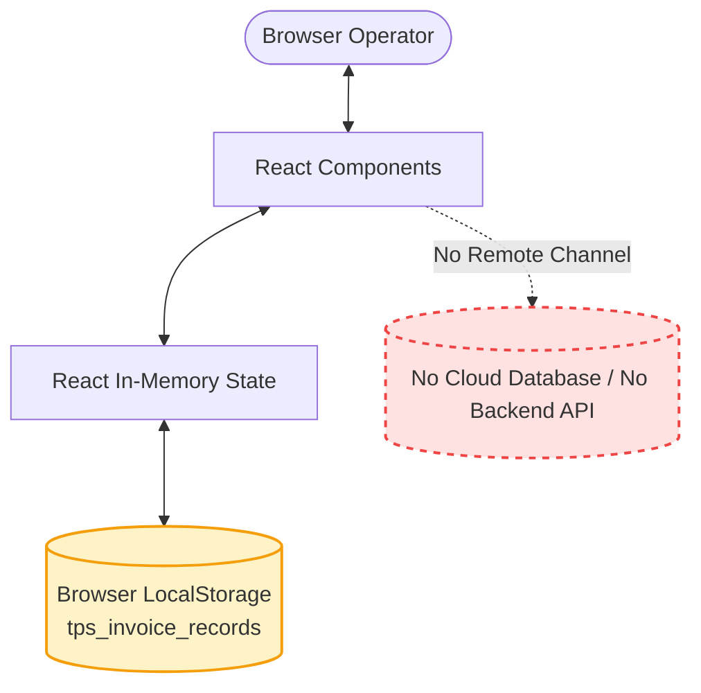

# Security Assessment and System Limitations

> **Document Status:** Active & Verified  
> **Last Updated:** October 2026  
> **Target System:** TPS BATTERYS HOUSE — Invoice Management Application  
> **Deployment Architecture:** Client-side Single Page Application (React 19 / Vite 8 / Tailwind CSS 3)

---

## 1. Executive Security & Architecture Summary

The **TPS BATTERYS HOUSE** application is currently engineered as a **purely client-side, browser-resident Single Page Application (SPA)**. It relies on in-memory React state and browser `localStorage` for all persistence and data operations.

There is **no remote backend server, database, or cloud synchronization layer** connected to this application.

> [!WARNING]
> **Production Alert:** This application is **not production-secure** for enterprise multi-user accounting or multi-branch operations in its current architecture. Storing sensitive customer GSTINs, phone numbers, and financial transactions exclusively in unencrypted client-side browser storage carries substantial operational, data-loss, and regulatory risks.

---

## 2. Feature Implementation Status Matrix

The following table explicitly classifies every core capability of the application based on rigorous audit evidence:

| Feature / Domain | Classification | Current State & Technical Reality |
| :--- | :--- | :--- |
| **User Authentication** | **Simulated** | Profile modal displays hardcoded mock operator details ("Alex Johnson", Store Manager). Sign-in / Sign-out buttons only toggle local UI states. No cryptographic sessions, tokens (JWT), cookies, or password verification exist. |
| **Role-Based Access Control (RBAC)** | **Not Implemented** | Any person with physical access to the browser session can create, edit, change statuses, or delete invoices. There are no privilege levels (Admin vs. Cashier vs. Read-Only). |
| **Data Persistence** | **Implemented (Client-Only)** | Serialized JSON stored in `localStorage` under `tps_invoice_records`. Bounded to a single browser profile on a single physical machine. |
| **Multi-Device Synchronization** | **Not Implemented** | Changes made on one phone, laptop, or desktop are completely isolated to that specific browser instance and will never sync to other devices. |
| **Financial Calculations (GST)** | **Implemented** | Accurate mathematical derivation of line totals, discounts, scrap trade-in, CGST/SGST/IGST, and Indian currency rounding in `gstCalculations.js`. |
| **Server-Side Validation** | **Not Implemented** | All input checking occurs strictly in browser JavaScript. An operator or script executing in DevTools can bypass form rules. |
| **Backup & Disaster Recovery** | **Not Implemented** | There is no automatic cloud snapshot, database replica, or periodic remote export. If browser data is cleared, all records are permanently destroyed. |
| **Audit Logging & History** | **Not Implemented** | Invoices track an `updatedAt` / `createdAt` timestamp in their payload, but there is no append-only immutable audit trail recording *who* modified or deleted an invoice. |
| **Payment Processing** | **Simulated / Manual** | Invoices can be toggled between `Paid`, `Pending`, and `Overdue`. No UPI payment gateway, POS terminal webhook, or bank reconciliation is integrated. |
| **PDF Generation & Printing** | **Implemented (Client-Only)** | Utilizes browser `window.print()` and client-side CSS media print stylesheets. |

---

## 3. Storage & Persistence Risks (`localStorage`)

### 3.1 Unencrypted Plaintext Storage
- **Mechanism:** Browser `localStorage` writes data in UTF-16 plaintext strings to the user's local disk.
- **Risk:** Any extension installed in the browser, any malicious script loaded via an XSS vulnerability, or any user with physical access to the terminal workstation can read the complete invoice database, customer phone numbers, addresses, and GSTINs by running `localStorage.getItem('tps_invoice_records')`.

### 3.2 Accidental Data Purging
- **Mechanism:** `localStorage` is not a durable database. It can be wiped at any moment by:
  1. The user clicking "Clear Browsing Data" / "Clear Cookies and Site Data".
  2. Operating system disk-cleanup utilities or browser privacy extensions.
  3. Browser storage quota eviction policies when system storage runs low.
  4. Opening the application in an "Incognito / Private Browsing" window (which automatically discards all storage on window close).
- **Impact:** Permanent, unrecoverable data loss for any commercial invoices created during that session.

### 3.3 Storage Quota Limits
- **Mechanism:** Browser `localStorage` typically enforces a strict origin quota of **5MB to 10MB**.
- **Impact:** While JSON invoice metadata is lightweight, storing thousands of complex itemized invoices over years of operation will eventually hit quota limits (`DOMException: QuotaExceededError`), leading to failed invoice saves unless a true database is introduced.

---

## 4. Authentication & Operator Simulation

The application interface includes an operator profile avatar and a "Sign In / Sign Out" toggle in `UserProfileModal.jsx` and `Header.jsx`.

> [!IMPORTANT]
> **Authentication Disclaimer:**
> The profile details:
> - **Operator Name:** Alex Johnson
> - **Role:** Store Manager
> - **Employee ID:** TPS-OP-4421
> - **Contact:** alex.j@tpsbatterys.com
> 
> Are **entirely simulated for demonstration purposes**. No actual user credentials exist in the codebase.
> 
> 1. Entering credentials or clicking "Sign In" does not issue an authentication challenge or query an identity provider (OAuth/LDAP/Active Directory).
> 2. There is no session expiration or idle timeout.
> 3. Do not rely on this modal for workstation access control or operator accountability.

---

## 5. Input Validation & Injection Risks

### 5.1 Client-Side Sanitization & XSS
- **React Escaping:** The application utilizes standard React JSX data binding (`{invoice.customer.name}`, `{item.description}`), which automatically escapes HTML entities and prevents classic Cross-Site Scripting (XSS) via form inputs.
- **`dangerouslySetInnerHTML` Audit:** A full repository search confirmed **zero instances** of `dangerouslySetInnerHTML`.
- **Limitation:** In the absence of server-side sanitization, malformed or malicious payloads injected directly into `localStorage` could corrupt application rendering or trigger prototype pollution if untrusted properties are read.

### 5.2 Date Parsing & Regional Formats
- Form inputs utilize native HTML5 `<input type="date">` returning standardized ISO `YYYY-MM-DD` strings.
- JavaScript `new Date()` parsing with defensive checks (`!isNaN(parsedDate)`) has been implemented to prevent locale-dependent date misinterpretations.

---

## 6. Dependency & Supply Chain Posture

An audit of `package.json` revealed a minimal, modern dependency tree:
- **`react` & `react-dom`:** v19.2.0 (Latest React core)
- **`lucide-react`:** v1.16.0 (SVG icon library)
- **`vite`:** v8.0.0 (Modern, lightweight build tool)
- **`tailwindcss`:** v3.4.19 & `postcss` (Utility CSS engine)
- **`oxlint`:** v1.50.0 (Rust-based linter)

### Dependency Security Notes
1. **Zero External Network Dependencies at Runtime:** The built client bundles all vendor assets locally. It makes zero runtime calls to external CDNs, tracking pixels, or third-party analytical scripts.
2. **No Backend Middleware Vulnerabilities:** Because there is no Node/Express server runtime, traditional server vulnerabilities (e.g., SSRF, server prototype pollution, remote code execution) are non-existent in the deployed artifact.

---

## 7. Recommended Production Security Checklist

Before deploying this software in a multi-user retail or commercial enterprise environment, the following security controls must be implemented:

- [ ] **Establish a Secure Backend API:** Implement a hardened REST or GraphQL backend (e.g., Node/Fastify, Go, or Python) running behind an HTTPS reverse proxy (Nginx / Cloudflare).
- [ ] **Relational Database Storage:** Migrate storage to PostgreSQL or MySQL with ACID compliance, relational foreign keys, and point-in-time database snapshots.
- [ ] **Enterprise Authentication:** Implement JWT or session-based authentication backed by bcrypt/Argon2 password hashing or OAuth2 / OpenID Connect.
- [ ] **Server-Side Validation:** Enforce strict schema validation (using Zod or Joi) on the server to prevent tamper-prone monetary manipulations.
- [ ] **Append-Only Audit Log:** Maintain an immutable ledger recording every invoice creation, status change, discount override, and cancellation with operator IDs and timestamps.
- [ ] **Automated Daily Backups:** Configure off-site encrypted backups of all invoice data with tested disaster recovery procedures.
- [ ] **Role-Based Permissions:** Restrict invoice deletion, discount overrides, and tax rate configuration to authorized store managers.
