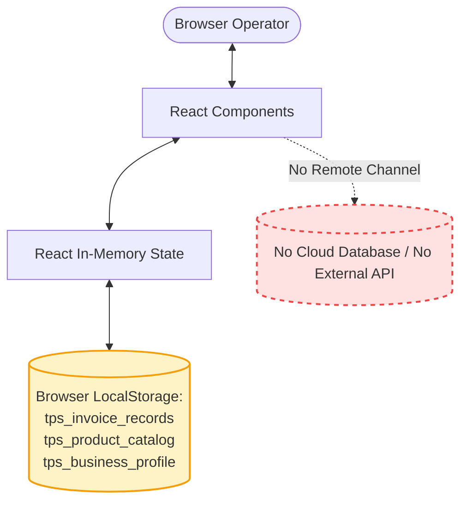

# Security Assessment and System Limitations

> **Document Status:** Active & Verified  
> **Last Updated:** November 2026  
> **Target System:** TPS BATTERYS HOUSE — Multi-Category Invoice Management Application  
> **Deployment Architecture:** Client-side Single Page Application (React 19 / Vite 8 / Tailwind CSS 3)

---

## 1. Executive Security & Architecture Summary

The **TPS BATTERYS HOUSE** application is engineered as a **purely client-side, browser-resident Single Page Application (SPA)**. It relies on in-memory React state and browser `localStorage` for all invoice records and product catalog entries.

There is **no remote backend server, cloud database, or synchronization API** connected to this application.

> [!WARNING]
> **Production Alert:** This application is **not production-secure** for multi-user accounting or multi-branch operations in its current standalone architecture. Storing sensitive customer GSTINs, phone numbers, and financial transactions exclusively in unencrypted client-side browser storage carries operational, data-loss, and regulatory risks.

---

## 2. Feature Implementation Status Matrix

The following table explicitly classifies every core capability of the application:

| Feature / Domain | Classification | Current State & Technical Reality |
| :--- | :--- | :--- |
| **Multi-Category Invoicing** | **Implemented** | Full support for Battery, Inverter, Solar, and Services line items with dynamic technical specifications and independent GST/HSN parameters. |
| **Product Catalog Management** | **Implemented (Client-Only)** | Centralized catalog stored in `tps_product_catalog` with category filters, brand filters, live search, and CRUD capabilities. |
| **Stock / Inventory Deduction** | **Not Implemented** | The product catalog does NOT track live physical stock quantities. Stock management and catalog management remain deliberately separated. |
| **User Authentication** | **Simulated** | Profile modal displays hardcoded mock operator details ("Alex Johnson"). Sign-in/Sign-out buttons toggle local UI state. No cryptographic tokens or cookies exist. |
| **Role-Based Access Control (RBAC)** | **Not Implemented** | Any person with physical access to the browser session can create, edit, or delete catalog products and invoice records. |
| **Data Persistence** | **Implemented (Client-Only)** | Serialized JSON stored in browser `localStorage`. Bounded strictly to a single browser profile on a single physical machine. |
| **Multi-Device Synchronization** | **Not Implemented** | Invoices or products created on one device do not synchronize with other devices. |
| **Financial Calculations (GST)** | **Implemented** | Precise multi-HSN mathematical derivation of line totals, discounts, scrap trade-in, CGST/SGST/IGST, and Indian currency rounding in `gstCalculations.js`. |
| **Vector PDF Generation** | **Implemented (Client-Only)** | Ultra-lightweight vector PDF generator using `jspdf` (~78 KB - 85 KB) with 100% selectable text, crisp vector lines, and embedded UPI QR code. |

---

## 3. Storage & Persistence Risks (`localStorage`)

### 3.1 Unencrypted Plaintext Storage
- Browser `localStorage` writes data in UTF-16 plaintext strings to the user's local disk profile.
- Any browser extension, script running in DevTools, or unauthorized person with physical access can read the complete invoice records and product catalog via `localStorage.getItem('tps_invoice_records')` and `localStorage.getItem('tps_product_catalog')`.

### 3.2 Accidental Data Purging
- Browser `localStorage` is not a durable database. It can be purged by:
  1. The operator clicking "Clear Browsing Data" / "Clear Cookies and Site Data".
  2. Operating system disk-cleanup utilities.
  3. Browser storage quota eviction policies.
  4. Operating in an "Incognito / Private Browsing" window.
- **Mitigation:** Operators must frequently download and archive generated PDF invoices.

### 3.3 Storage Quota Limits
- Browser `localStorage` typically enforces an origin quota of **5MB to 10MB**. Storing thousands of detailed mixed-category invoices over years will eventually exceed this quota unless migrated to an IndexedDB or cloud database backend.

---

## 4. Statutory & Tax Compliance Disclaimer

> [!CAUTION]
> **Tax Advisory Notice:**
> The default HSN codes and GST percentages provided in the application presets:
> - `8507` @ 28% for Lead-Acid & Lithium Batteries
> - `8504` @ 18% for Inverters, Converters, and UPS Systems
> - `8541` @ 12% for Solar Photovoltaic Modules / Solar Cells
> - `9954` / `9987` @ 18% for Installation, Commissioning, and Maintenance Services
> 
> Are industry-standard starting configurations. GST rates on renewable energy equipment and composite works contracts are subject to state notifications and CBIC circulars. The application provides fully editable tax fields on every line item so that operators can align calculations with their certified tax advisor's instructions.
