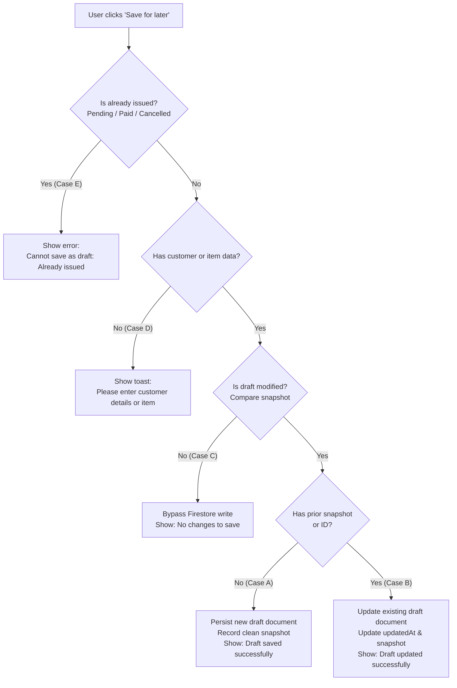

# Draft Dirty-State Analysis & Form Lifecycle Tracking
## TPS Battery House — Unchanged Invoice Handling

### 1. The Problem: Redundant Writes on Unchanged Drafts

Prior to this repair, the New Bill / Invoice editor treated every click on **Save for later** identically, regardless of whether the form had been modified, was an existing clean draft, was a blank form, or was an already-issued invoice.

This caused two critical flaws:
1. **Unnecessary Firestore Traffic**: Re-saving an unmodified draft issued a `setDoc({ merge: true })` call to Firestore on every click.
2. **Rule Evaluation Failures**: On unmodified existing drafts, this redundant update invoked the Firestore rules engine, hitting the CEL expression limit or risking accidental field mutations.

---

### 2. Five Distinct Invariant Lifecycle Cases

To ensure complete robustness and user convenience, the editor now partitions draft persistence into 5 deterministic cases:

#### Case A — New invoice with data, never saved
- **Trigger**: User starts new bill, enters customer/items, clicks **Save for later**.
- **Action**: Persists complete state as a fresh Draft document in Firestore.
- **Result**: Generates stable draft identifier (`DRAFT-xxxxxx`), records `lastSavedSnapshotRef.current`, and presents `"Draft saved successfully"`.

#### Case B — Existing draft with modifications
- **Trigger**: User re-opens an existing draft, edits quantities, rates, or discounts, and clicks **Save for later**.
- **Action**: Updates existing draft document in Firestore.
- **Result**: Preserves document ID, `createdAt`, `createdBy`, and `invoiceNumber`. Sets `updatedAt`. Updates snapshot.

#### Case C — Existing draft without modifications
- **Trigger**: User re-opens an existing draft (or populates one) and clicks **Save for later** without changing any field.
- **Action**: `isDraftModified(invoice, lastSavedSnapshot)` returns `false`.
- **Result**: Completely skips Firestore network call. Displays `"No changes to save. Your draft is already up to date."`

#### Case D — New invoice without any meaningful data
- **Trigger**: User opens clean blank bill template and immediately clicks **Save for later**.
- **Action**: `hasMeaningfulInvoiceData(invoice)` returns `false`.
- **Result**: Prevents creating useless empty drafts in Firestore. Displays `"Please enter customer details or add at least one product or service before saving as draft."`

#### Case E — Previously issued invoice
- **Trigger**: User opens a `Pending`, `Paid`, or `Cancelled` invoice and clicks **Save for later**.
- **Action**: `isIssuedInvoice(invoice)` detects official status.
- **Result**: Strictly blocks converting issued bills back to drafts. Displays `"Cannot save as draft: This bill has already been issued as ${paymentStatus}."`

---

### 3. Implementation Details

Located in [src/utils/draftState.js](file:///home/navaneeth/Documents/Amal/src/utils/draftState.js):
- `hasMeaningfulInvoiceData(invoice)`: Evaluates customer details and non-empty line items.
- `isIssuedInvoice(invoice)`: Checks if status is `['Pending', 'Paid', 'Cancelled', 'Overdue']`.
- `createDraftSnapshot(invoice)`: Normalizes all editable form fields into a canonical JSON object.
- `isDraftModified(current, lastSaved)`: Performs deep equality comparison against the clean snapshot.
