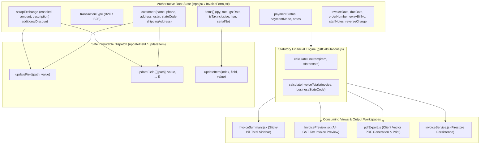

# TPS BATTERY HOUSE — State Ownership & Architectural Review

## 1. Core State Ownership Principle
To prevent race conditions, stale closures, and accidental mutations across the TPS BATTERY HOUSE invoice generator, every piece of information belongs strictly to one of two categories:

1. **Authoritative Source State:** Maintained at the application root (`src/App.jsx` and `src/components/InvoiceForm.jsx`), modified exclusively through immutable user actions.
2. **Authoritative Derived State:** Purely computed by `src/utils/gstCalculations.js` (`calculateInvoiceTotals`), never cached or duplicated as competing editable state.

---

## 2. State Ownership Hierarchy Diagram

---

## 3. Enforcement Rules
1. **No Derived State Write-Back:** Totals (e.g. `totalGross`, `totalTax`, `netPayable`) are computed on-the-fly during render and must never be fed back into form inputs as editable fields.
2. **Zero-Side-Effect Calculations:** `calculateInvoiceTotals` and `calculateLineItem` are pure functions. They never mutate the `invoice` or `items` array.
3. **Atomic Multi-Field Updates:** When multiple dependent fields are changed simultaneously (e.g., GSTIN + stateCode + PAN, or scrapExchange.amount + scrapExchange.enabled), they are batched into a single immutable update.
4. **Controlled Child Views:** Child sections (`InvoiceItemsSection`, `CustomerDetailsSection`) do not maintain competing copies of form values in local `useState`. Local UI state is restricted to transient visibility toggles.

