# PRINT BUTTON FAILURE — ROOT CAUSE ANALYSIS & DIAGNOSTIC REPORT

**Project:** TPS BATTERY HOUSE — GST Billing & Invoice Management System  
**Auditor:** Senior Frontend Engineer, Browser Printing Specialist & PDF Generation Engineer  
**Defect Severity:** CRITICAL (Printing Failure / Black Blank Page)  
**Target:** Local Development (`http://localhost:5173/`)  
**Resolution Status:** ROOT CAUSE CONFIRMED  

---

## 1. Executive Summary

When a user clicked the **Print** button on the New Tax Invoice screen (`activeView === 'editor'`, `editorMode === 'edit'`), the browser opened a print dialog displaying a completely black, blank page rather than the actual GST Tax Invoice.

A thorough trace of the DOM structure, CSS stylesheets, and event handling revealed two concurring root causes:

1. **Unmounted Invoice Component during Editor Mode:**  
   The actual printable GST invoice component (`<InvoicePreview id="invoice-printable" ... />`) was conditionally rendered **only** when `editorMode === 'preview'` or `editorMode === 'split'`. While the user was in the primary editor screen (`editorMode === 'edit'`), `<InvoicePreview>` was **not mounted in the DOM at all**.

2. **Aggressive Print Hiding (`.no-print`) combined with Dark Application Container (`bg-slate-950`):**  
   In `src/App.jsx`, `<InvoiceForm>` was wrapped inside `
`. In `src/index.css`, `.no-print { display: none !important; }` hides the form, the header, and all action buttons during `@media print`. Simultaneously, the root application container had Tailwind class `min-h-screen bg-slate-950 text-slate-100` (`#020617` / nearly pure black).  
   Because `<InvoicePreview>` was absent from the DOM, and all other elements were hidden with `display: none !important`, the browser printed the empty, full-height `#020617` black application background.

3. **Naive Synchronous `window.print()` Execution:**  
   The `handlePrint` callback in `src/App.jsx` simply invoked `window.print()` synchronously without verifying DOM readiness, without mounting `<InvoicePreview>`, and without utilizing the existing crisp A4 vector PDF engine.

---

## 2. Forensic Trace of the 10 Diagnostic Questions

### 1. Which component handles the click?
- **Component:** `src/components/invoice/InvoiceActionBar.jsx` (Lines 87–98).
- **Element:** `<button type="button" onClick={onPrint} ... title="Print A4 Tax Invoice">`.

### 2. Which callback is invoked?
- The click bubbles from `InvoiceActionBar` $\to$ `InvoiceForm` $\to$ `handlePrint` in `src/App.jsx` (Lines 340–344).

### 3. Whether it opens a new browser window?
- **No.** The previous implementation did not open a new browser window; it invoked `window.print()` directly on the host window.

### 4. Whether it creates an iframe?
- **No.** No print iframe existed in the prior code.

### 5. Whether it navigates to another route?
- **No.** The route remained on the current page (`activeView === 'editor'`), but because the document was emptied by `.no-print`, it appeared as though it navigated to an empty black page.

### 6. Whether it renders a hidden invoice component?
- **NO.** There was no hidden or offscreen `<InvoicePreview>` mounted when `editorMode === 'edit'`. `<InvoicePreview>` only existed inside the conditional block `{editorMode === 'preview' && ...}` (Lines 535–545).

### 7. Whether it calls `window.print()`?
- **YES.** `handlePrint` in `src/App.jsx` executed `window.print()` directly.

### 8. Whether it invokes the existing PDF generator?
- **NO.** While `handleDownloadPdf` called `generateVectorPdf` via `downloadInvoicePdf`, `handlePrint` completely bypassed the existing vector PDF generator.

### 9. Whether it relies on print-specific CSS?
- **YES.** It relied on `@media print` in `src/index.css`. However:
  - `.no-print` hid `<InvoiceForm>`, `<Header>`, and floating buttons.
  - The only element that print-specific CSS was designed to display (`#invoice-printable`) was NOT in the DOM.
  - The Tailwind background class `.bg-slate-950` on the root container was not stripped by `@media print`, resulting in an empty black sheet.

### 10. Whether any asynchronous operation completes before printing?
- **NO.** `window.print()` was called immediately and synchronously, before any React state updates could flush.

---

## 3. Structural Comparison (Before vs. Expected)

```mermaid
flowchart TD
    subgraph Pre-Fix Behavior
        A1["User Clicks Print Button"] --> B1["handlePrint() in App.jsx"]
        B1 --> C1["Calls window.print() synchronously"]
        C1 --> D1{"Is InvoicePreview in DOM?"}
        D1 -- "NO (editorMode === 'edit')" --> E1["#invoice-printable MISSING"]
        E1 --> F1[".no-print hides InvoiceForm and Header"]
        F1 --> G1["Root container bg-slate-950 remains"]
        G1 --> H1["Result: 100% BLACK BLANK PAGE"]
    end

    subgraph Expected Correct Behavior
        A2["User Clicks Print Button"] --> B2["isPrinting State Active (UX Spinner)"]
        B2 --> C2["verifyInvoiceFinancialConsistency Guard"]
        C2 --> D2["Option A: printInvoicePdf creates Vector PDF Blob & prints via invisible frame"]
        C2 --> E2["Option B: Always mount InvoicePreview in print:block container in DOM"]
        D2 --> F2["Browser Print Dialog Opens with Crisp A4 GST Invoice"]
        E2 --> F2
        F2 --> G2["Form State Preserved & White Paper Background Guaranteed"]
    end
```

---

## 4. Conclusion & Required Solution Architecture

To permanently resolve this defect:
1. **Option A (Primary Vector Print Engine):** Create a dedicated `printInvoicePdf` function in `src/utils/pdfExport.js` that compiles the authoritative vector PDF into an in-memory Blob and opens the browser print dialog via an isolated print frame.
2. **Option B (DOM Print Layer):** Always mount `<InvoicePreview>` inside a dedicated `hidden print:block print:w-full` container in `src/App.jsx` so that native browser printing (`window.print()`) ALWAYS finds `#invoice-printable`, even while the user is actively typing in `editorMode === 'edit'`.
3. **CSS Dark Background Invalidation:** Update `src/index.css` `@media print` to force `#root`, `#root > div`, `.min-h-screen`, and `body` to `background: #ffffff !important;` and `background-color: #ffffff !important;`.
4. **Interactive UX Feedback:** Add `isPrinting` loading state to the Print button to show `Preparing Print...` with a spinner and prevent double-clicks.

