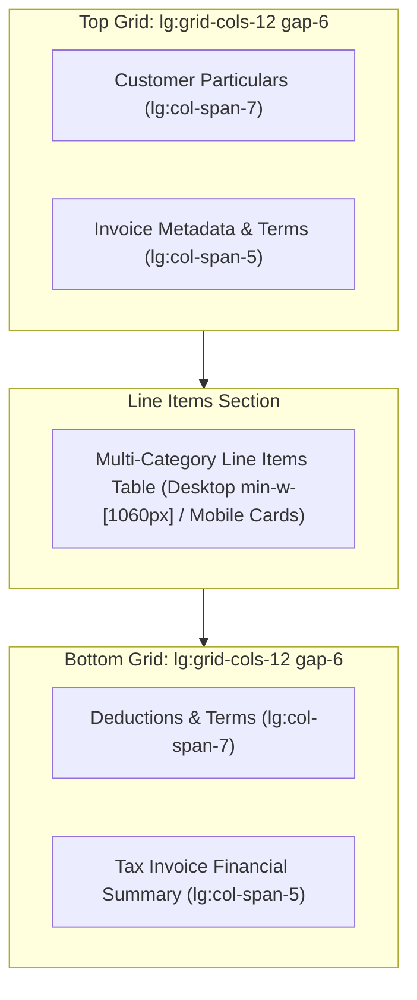

# TPS BATTERY HOUSE — INVOICE SCREEN LAYOUT IMPLEMENTATION SUMMARY
## Engineering Modifications, Grid Rebalancing & Zero-Logic Verification

**Implementation Date:** November 9, 2026  
**Engineering Team:** Frontend Architecture & UI/UX Design  
**Branch:** `update/invoiceScreen`  

---

## 1. Overview of Changes

Targeted CSS layout and responsive structure corrections were implemented across 6 key components without altering any business logic, GST formulas, persistence layers, or user workflows.

---

## 2. File-by-File Modifications

### 2.1 `src/components/InvoiceForm.jsx`
- **Replaced:** `
`
- **With:** `
`
- **Allocations:**
  - `CustomerDetailsSection`: Changed from `lg:col-span-2` to `lg:col-span-7`.
  - `InvoiceMetadataSection`: Changed from `lg:col-span-1` to `lg:col-span-5`.
- **Result:** Provides a 25% increase in horizontal card real estate for Metadata on desktop screens, while vertically aligning the top two cards with the bottom two cards (`lg:col-span-7` / `lg:col-span-5`).

### 2.2 `src/components/invoice/InvoiceMetadataSection.jsx`
- **Replaced:** `
` with nested `lg:col-span-4`.
- **With:** `
`.
- **Field Rebalancing:**
  - Row 1: `Invoice Date *` (Col 1) | `Payment Due Date` (Col 2).
  - Row 2: `Reverse Charge Applicable` (Col 1) | `Buyer PO / Work Order No` (Col 2).
  - Row 3: `E-Way Bill Number` (Col 1) | `IRN / E-Invoice Hash` (Col 2).
- **Collision Prevention in Due Date:**
  - Restructured label header with `flex flex-wrap items-center justify-between gap-1 mb-1`.
  - Added `shrink-0` to label and quick terms chips container.
- **Truncation Prevention:**
  - Added `min-w-0` to all inputs, selects, and parent wrappers.
  - Added `truncate` to select elements and optional reference labels.

### 2.3 `src/components/invoice/CustomerDetailsSection.jsx`
- Added `min-w-0` across all 11 inputs and dropdown trigger.
- Upgraded vertical spacing from `space-y-1` to `space-y-1.5`.
- Restructured customer GSTIN header with `flex flex-wrap items-center justify-between gap-1.5` so validation feedback chips never collide with the label.

### 2.4 `src/components/invoice/InvoiceItemsSection.jsx`
- Added `min-w-[1060px]` to the desktop `<table>` element.
- Retained the outer `overflow-x-auto` wrapper with smooth border bounds.
- Guaranteed full mobile card stack (`isMobileCard={true}`) for viewports `< 1024px`.

### 2.5 `src/components/invoice/InvoiceItemRow.jsx`
- Enforced minimum widths on table cells:
  - Category: `w-32 min-w-[128px]`.
  - Item Description: `min-w-[260px]`.
  - Taxable Amount: `w-28 min-w-[100px] whitespace-nowrap`.
  - Line Total: `w-28 min-w-[100px] whitespace-nowrap`.

### 2.6 `src/components/invoice/InvoiceSummary.jsx`
- Applied `whitespace-nowrap` to all calculated numeric values: `totalGross`, `extraDiscount`, `scrapDiscount`, `totalTaxableValue`, `totalIgst`, `totalCgst`, `totalSgst`, `totalTax`, `roundOff`, and `netPayable`.
- Added `break-words leading-relaxed` to `amountInWords` container.

### 2.7 `src/components/invoice/InvoiceTermsSection.jsx`
- Applied `min-w-0` to column wrappers.
- Restricted textarea resize behavior to vertical-only (`resize-y`) to prevent grid blowouts.

### 2.8 `src/components/invoice/InvoiceDeductionsSection.jsx`
- Restructured manual round-off header with `flex flex-wrap items-center justify-between gap-1` and `shrink-0` on the "Reset to Auto" button.

---

## 3. Business Logic & Financial Integrity Guarantee

1. **GST Calculation Integrity:** Identical formulas in `src/utils/gstCalculations.js` (`calculateLineItem`, `calculateInvoiceTotals`, `verifyInvoiceFinancialConsistency`).
2. **Draft & Invoice Persistence:** Zero changes to `handleSaveDraft`, `handleSaveInvoice`, or Firestore transactional persistence.
3. **Print & PDF Workflows:** The `.print-only` container and vector PDF streaming (`generateVectorPdf`, `printInvoicePdf`) remain fully intact.
4. **Theme Consistency:** 100% adherence to slate dark-mode palette (`bg-slate-900`, `bg-slate-950`, `border-slate-800`, `text-amber-400`).

