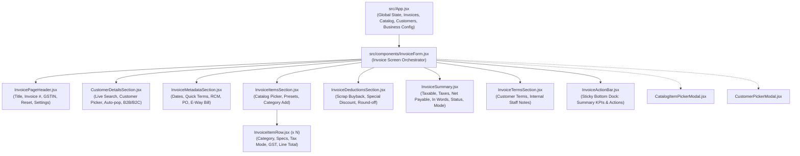

# Deliverable 3: Component Architecture & State Flow

**Document Version:** 1.0.0  
**Phase:** New Tax Invoice Screen — Google Stitch Design Integration  
**Project:** TPS BATTERY HOUSE — GST Billing & Invoice Management System  
**Date:** November 2026  

---

## 1. Component Hierarchy & Data Flow



---

## 2. Unidirectional State Management

- **Single Source of Truth:** `invoice` state lives in `src/App.jsx` and is passed as a prop into `InvoiceForm`.
- **Atomic Functional Updaters:** Handlers update nested properties immutably:
  ```javascript
  const updateInvoiceField = (field, value) => {
    setInvoice((prev) => ({ ...prev, [field]: value }));
  };

  const updateCustomerField = (field, value) => {
    setInvoice((prev) => ({
      ...prev,
      customer: { ...(prev.customer || {}), [field]: value },
    }));
  };

  const updateLineItem = (index, updatedItem) => {
    setInvoice((prev) => {
      const nextItems = [...(prev.items || [])];
      nextItems[index] = updatedItem;
      return { ...prev, items: nextItems };
    });
  };
  ```

---

## 3. Real-time Calculation Pipeline

Calculations are driven by the authoritative Phase 5.3 mathematical engine (`src/utils/gstCalculations.js`):
1. **Line-Level Execution:** For every item in `invoice.items`, `calculateLineItem` determines base taxable value, CGST, SGST, IGST, and line total using exact `roundToTwoDecimals`.
2. **Invoice-Level Aggregation:** `calculateInvoiceTotals(invoice, business.stateCode)` aggregates line items, applies scrap buyback deductions, special discounts, and handles automatic or manual round-off.
3. **Propagated Metrics:** Calculated values (`totals`) are passed simultaneously to `InvoiceSummary` and `InvoiceActionBar` with zero state desynchronization.

