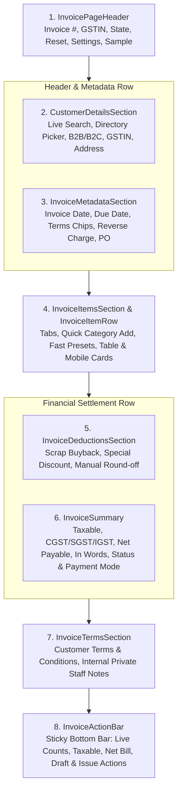

# Deliverable 1: Reference Design Analysis & Mapping

**Document Version:** 1.0.0  
**Phase:** New Tax Invoice Screen — Google Stitch Design Integration  
**Project:** TPS BATTERY HOUSE — GST Billing & Invoice Management System  
**Target File:** `src/components/InvoiceForm.jsx` & `src/components/invoice/*`  
**Date:** November 2026  

---

## 1. Executive Summary

This document analyzes the supplied reference design titled **"TPS Battery House - Simplified Billing Dashboard"** and maps its architectural patterns, visual tokens, layout structure, and interaction paradigms into the React 19 production codebase.

The goal was to replace the fragmented, 3-tab creation interface with a continuous, unified full-page billing interface matching the premium dark charcoal/navy (`slate-950/900`) and amber (`amber-400/500`) brand aesthetic of TPS Battery House while preserving 100% of the Phase 5.3 financial precision, RBAC security, and Firestore persistence guarantees.

---

## 2. Visual Identity & Color System Comparison

| Design System Token | Reference Specification | Implementation Token | Status |
| :--- | :--- | :--- | :--- |
| **Page / Surface Background** | Deep navy charcoal (`#020617` / `#0b1120`) | Tailwind `bg-slate-950` / `bg-slate-900/60` | Exact Match |
| **Section Card Borders** | Subtle translucent border (`rgba(51, 65, 85, 0.5)`) | Tailwind `border-slate-800/80` | Exact Match |
| **Primary Accent Color** | Industrial solar amber (`#f59e0b` / `#fbbf24`) | Tailwind `bg-amber-500`, `text-amber-400` | Exact Match |
| **Secondary Category Accents** | Battery (Amber), Inverter (Sky), Solar (Emerald), Service (Purple) | `amber-400`, `sky-400`, `emerald-400`, `purple-400` | Exact Match |
| **Typography (Display & Body)** | Modern geometric sans-serif (Inter/Geist) | `font-sans text-slate-100` | Exact Match |
| **Typography (Financials)** | Tabular monospaced figures | `font-mono tracking-tight font-bold` | Exact Match |
| **Status Badges** | Soft tinted backgrounds with crisp borders | e.g. `bg-emerald-500/10 text-emerald-400 border border-emerald-500/20` | Exact Match |

---

## 3. Structural Decomposition & Mapping

The reference layout presents a single-page cohesive flow structured logically from client identification to final checkout:

---

## 4. Feature Gap & Architectural Enhancements

1. **Elimination of Tab Friction:**
   - *Previous state:* Users had to switch across 3 separate tabs ("Client & Items", "Transport & Terms", "Preview") to verify total calculations.
   - *Refactored state:* All details are visible simultaneously. Real-time updates immediately propagate across the header badge, table rows, deduction card, summary metrics, and the bottom action bar.

2. **Inline Customer Search vs Directory Picker:**
   - Integrated live predictive search across customer database (`name`, `phone`, `gstin`) with instantaneous autocomplete dropdown, accompanied by a full directory modal picker and one-click form clear.

3. **Multi-Category Quick Insert Buttons:**
   - Dedicated quick-action category pills allow instant insertion of pre-templated Battery, Inverter, Solar, or Service line items with pre-filled statutory HSN codes and default tax slabs.

4. **Private Staff Notes Protection:**
   - Dedicated staff notes field with security badge clearly distinguishing internal operational notes from public customer-facing invoice terms. Staff notes are strictly kept in the database record and never leaked onto print or PDF outputs.

