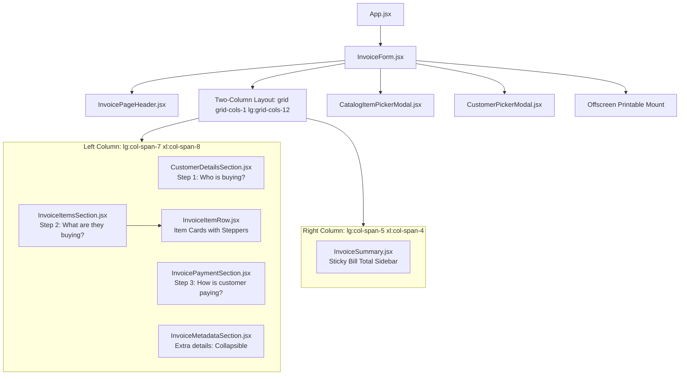

# TPS BATTERY HOUSE — INVOICE SCREEN REDESIGN
## 2. COMPONENT MAPPING SPECIFICATION

**Project:** TPS Battery House — GST Billing & Invoice Management  
**Scope:** New Tax Invoice Component Mapping & Architectural Layout  
**Date:** November 9, 2026  
**Status:** COMPLETED & VERIFIED

---

### 1. Component Architecture Overview

The previous interface relied on nine fragmented sub-components arranged across multiple stacked grids. The redesigned implementation maps these responsibilities into a cohesive, streamlined component hierarchy based directly on `Simple New Bill – New Bill.html`:

---

### 2. Detailed Component Responsibilities & Mapping

| Component | File Path | New Role & Responsibilities | Key Props & State Mappings |
| :--- | :--- | :--- | :--- |
| **`InvoiceForm`** | `src/components/InvoiceForm.jsx` | Orchestrator component. Manages form state, modal visibility, and authoritative calculations (`calculateInvoiceTotals`). | `invoice`, `setInvoice`, `catalog`, `customers`, `onSave`, `onPrint`, `onPreview`, `onDownloadPdf` |
| **`InvoicePageHeader`** | `src/components/invoice/InvoicePageHeader.jsx` | Top header display. Shows back link, `New Bill` heading, invoice number badge, date, customer type tag, and header action buttons. | `invoice`, `business`, `onReset`, `onLoadSample`, `onOpenSettings`, `onBackToDashboard` |
| **`CustomerDetailsSection`** | `src/components/invoice/CustomerDetailsSection.jsx` | **Step 1:** Customer particulars. Choice cards for B2C/B2B, directory search autocomplete, customer name, phone number, address, and conditional B2B GSTIN input. | `customer`, `onUpdateField`, `onSelectCustomer`, `customers`, `transactionType`, `onSetTransactionType` |
| **`InvoiceItemsSection`** | `src/components/invoice/InvoiceItemsSection.jsx` | **Step 2:** Line items container. Renders cards list, fast-add preset chips (`+ Exide...`), category chips, catalog modal trigger, and discount/scrap deduction toggles. | `items`, `onAddItem`, `onUpdateItem`, `onUpdateCategory`, `onRemoveItem`, `onOpenCatalogPicker`, `invoice` |
| **`InvoiceItemRow`** | `src/components/invoice/InvoiceItemRow.jsx` | Individual item card. Item title, warranty subtitle, stepper buttons (`−` / `+`), inline price input, line total, remove link, and expandable technical details drawer. | `item`, `index`, `onUpdateItem`, `onUpdateCategory`, `onRemoveItem`, `isInterstate` |
| **`InvoicePaymentSection`** | `src/components/invoice/InvoicePaymentSection.jsx` | **Step 3:** Payment & customer message. "Paid now" vs "Pay later" choice cards, payment mode pills (`Cash`, `UPI`, `Card`, `Bank transfer`), UPI QR hint, and customer note textarea. | `invoice`, `onUpdateField` |
| **`InvoiceMetadataSection`** | `src/components/invoice/InvoiceMetadataSection.jsx` | Collapsible "Extra details (not needed for most bills)" accordion. Contains PO number, delivery address, e-way bill, staff private notes, dates, and reverse charge. | `invoice`, `onUpdateField` |
| **`InvoiceSummary`** | `src/components/invoice/InvoiceSummary.jsx` | Sticky `Bill total` sidebar. Header summary, gross total, deductions, price before GST, statutory GST, round-off, hero "Customer pays" box, amount in words, and primary action buttons. | `invoice`, `totals`, `isInterstate`, `onSaveInvoice`, `onSaveDraft`, `onPreview`, `onPrint`, `onDownloadPdf`, `onShareWhatsApp` |

---

### 3. State & Event Flow

1. **Transaction Type Toggling**: Clicking "Regular customer (B2C)" or "Business customer (B2B)" updates `invoice.transactionType`. In B2B mode, the Business GST number field is conditionally displayed and auto-formats to uppercase.
2. **Item Quantity Stepping**: Clicking `+` or `−` calls `onUpdateItem(index, 'qty', newQty)`. Line calculations and overall invoice totals update in real-time.
3. **Discount & Scrap Toggling**: Clicking "+ Give a discount" opens an inline input updating `invoice.additionalDiscount`. Clicking "+ Customer is giving an old battery" opens an inline input updating `invoice.scrapExchange.amount` and enables eco-exchange.
4. **Payment Mode Selection**: Clicking a payment mode pill updates `invoice.paymentMode`. Selecting "Paid now" sets status to `Paid`; selecting "Pay later" sets status to `Pending`.
5. **Bill Action Dispatching**: Clicking "Save & Print Bill" executes `handleSaveAndPrint()`, which commits the invoice to Cloud Firestore (with transaction concurrency and reservation locks intact) and immediately triggers vector PDF printing.

