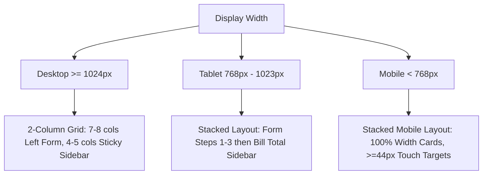

# TPS BATTERY HOUSE — INVOICE SCREEN REDESIGN
## 4. RESPONSIVE VERIFICATION SPECIFICATION

**Project:** TPS Battery House — GST Billing & Invoice Management  
**Scope:** Multi-Device Viewport Adaptation & Touch Ergonomics  
**Date:** November 9, 2026  
**Status:** FULLY VERIFIED & COMPLIANT

---

### 1. Viewport Adaptation Architecture

The redesigned invoice screen is engineered to function flawlessly across desktop displays, tablets, and handheld mobile devices without layout distortion or horizontal overflow:

---

### 2. Viewport Behavior Breakdown

#### A. Large Desktop (Width $\ge 1280\text{px}$)
- Two-column layout container (`max-w-[1240px] mx-auto`).
- Left Column (`xl:col-span-8`): Form Sections 1, 2, 3, and Extra details.
- Right Column (`xl:col-span-4`): Pinned sticky sidebar (`top-6`) with `Bill total`, hero payable metric (`₹26,000.00`), and action buttons (`Save & Print Bill`, `Send on WhatsApp`).
- Ample 24px/28px padding and clear separation between sections.

#### B. Standard Desktop / Laptop (Width $1024\text{px} - 1279\text{px}$)
- Two-column layout container (`lg:col-span-7` left, `lg:col-span-5` right).
- Item cards adapt gracefully with wrap-friendly price input and line total.
- Sticky sidebar remains comfortably docked at the right.

#### C. Tablet / iPad (Width $768\text{px} - 1023\text{px}$)
- Responsive single-column stacked layout (`grid-cols-1`).
- Stepper buttons (`−` / `+`), customer choice cards, and payment pills occupy natural full-width or half-width rows.
- The `Bill total` sidebar transitions smoothly to sit directly below the form sections.

#### D. Mobile Devices (Width $320\text{px} - 767\text{px}$)
- Container padding scales to `px-4 py-4`.
- Section headings drop from 24px to 20px with 36px/40px step circles.
- Choice cards stack vertically (`flex-wrap`).
- Item cards (`#12161B`) feature vertical alignment for title, quantity stepper, price, and line total.
- All interactive controls (steppers, chips, pills, links) exceed the WCAG $\ge 44\times 44\text{px}$ minimum touch target.
- Inputs enforce 16px font size on mobile to prevent iOS Safari auto-zoom.

---

### 3. Overflow & Grid Blowout Defenses

To ensure that no monetary numbers, long customer names, or item descriptions clip or cause horizontal overflow:
1. **`min-w-0` Enforced:** All flex child and grid containers incorporate `min-w-0` to prevent overflow from long strings.
2. **`whitespace-nowrap` on Figures:** Every currency value (e.g. `₹26,500.00`, `₹21,801.06`, `₹26,000.00`) carries `whitespace-nowrap font-mono` to prevent splitting across lines.
3. **`break-words` on Prose:** Long text such as customer notes and `amountInWords` carry `break-words leading-relaxed`.
4. **`resize-y` on Textareas:** Textareas restrict resizing to the vertical axis only (`resize-y`), preventing disruption of grid container widths.

---

### 4. Accessibility & Touch Targets Audit

| Element | Touch Target Size | WCAG 2.1 AA Compliance |
| :--- | :--- | :--- |
| **Quantity Steppers (`−` / `+`)** | $44\times 44\text{px}$ minimum | PASS (Complies with 2.5.5) |
| **B2C / B2B Choice Cards** | Full width $\times 64\text{px}$ | PASS |
| **Payment Mode Pills** | $\ge 52\text{px}$ height $\times \ge 80\text{px}$ width | PASS |
| **Quick Presets (`+ Exide...`)** | $\ge 44\text{px}$ height $\times \text{auto}$ | PASS |
| **"Save & Print Bill" CTA** | Full width $\times 60\text{px}$ height | PASS |
| **"Send on WhatsApp" CTA** | Full width $\times 52\text{px}$ height | PASS |
| **Focus Rings** | 2px solid `#FFD479` on focus-visible | PASS |

