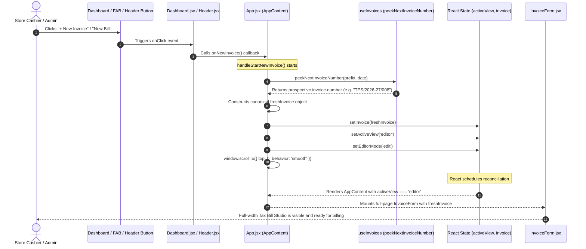

# CLICK EVENT TRACE — END-TO-END EVENT DISPATCH AUDIT

**Project:** TPS BATTERY HOUSE — GST Billing & Invoice Management System  
**Trace Route:** DOM Element Click -> Event Handler -> Parent Callback -> State Mutator -> View Re-render  

---

## 1. Trace Overview & Lifecycle Sequence



---

## 2. Granular Step-by-Step Code Trace

### Step 1: DOM Event Trigger
- **Component:** `src/components/Dashboard.jsx` (Lines 180–187)
  ```jsx
  <button
    type="button"
    onClick={onNewInvoice}
    className="w-full sm:w-auto px-4 py-2.5 bg-amber-500 hover:bg-amber-400 text-slate-950 font-bold rounded-xl text-xs sm:text-sm flex items-center justify-center gap-2 transition-all shadow-lg shadow-amber-500/20 active:scale-95 group"
  >
    <Plus className="w-4 h-4 stroke-[3] group-hover:rotate-90 transition-transform" />
    <span>New Invoice</span>
  </button>
  ```
- **Action:** User clicks on the button or child elements (`<Plus>` or `<span>`).
- **Bubbling:** The click event targets the button and triggers `onClick={onNewInvoice}`.

### Step 2: Prop Passing from App
- **Component:** `src/App.jsx` (Lines 418–424)
  ```jsx
  {activeView === 'dashboard' && (
    <Dashboard
      invoices={invoices}
      onNewInvoice={handleStartNewInvoice}
      onOpenInvoice={handleOpenInvoiceInEditor}
      onViewAllInvoices={() => setActiveView('invoices')}
    />
  )}
  ```
- **Action:** `Dashboard` invokes the `onNewInvoice` prop, bound directly to `handleStartNewInvoice`.

### Step 3: Sequence Allocation & Template Construction
- **Component:** `src/App.jsx` (Lines 210–248)
  ```javascript
  const handleStartNewInvoice = () => {
    const newInvNo = getNextInvoiceNumber();
    const today = new Date().toISOString().split('T')[0];

    const freshInvoice = {
      id: 'inv-' + Date.now(),
      invoiceNumber: newInvNo,
      invoiceDate: today,
      dueDate: today,
      transactionType: TRANSACTION_TYPES.B2B,
      paymentMode: 'Cash',
      paymentStatus: 'Draft',
      placeOfSupply: 'Kerala (32)',
      reverseCharge: 'No',
      customer: {
        name: '',
        phone: '',
        address: '',
        city: 'Thrithala',
        district: 'Palakkad',
        state: 'Kerala',
        stateCode: '32',
        pincode: '679552',
        gstin: '',
      },
      items: [
        {
          id: 'item-1',
          name: '',
          category: PRODUCT_CATEGORIES.BATTERY,
          subcategory: 'Tubular Battery',
          brand: '',
          model: '',
          specs: {},
          hsn: '8507',
          serialNo: '',
          warranty: '36 Months',
          qty: 1,
          unit: 'Nos',
          rate: 0,
          isTaxInclusive: true,
          gstRate: 28,
        },
      ],
      scrapExchange: {
        enabled: false,
        description: 'Old 150Ah Scrap Battery Buyback',
        amount: 0,
      },
      additionalDiscount: 0,
      roundOffManual: null,
      netPayable: 0,
      notes: 'Thank you for choosing TPS BATTERYS HOUSE.',
      createdAt: new Date().toISOString(),
    };
  ```

### Step 4: Atomic State Updates (Fixed)
- **Component:** `src/App.jsx` (Lines 240–247)
  ```javascript
    setInvoice(freshInvoice);
    setActiveView('editor');
    setEditorMode('edit');
    if (typeof window !== 'undefined' && typeof window.scrollTo === 'function') {
      window.scrollTo({ top: 0, behavior: 'smooth' });
    }
  };
  ```
- **State Changes:**
  - `invoice`: Transitioned from prior invoice or default sample to `freshInvoice`.
  - `activeView`: Transitioned from `'dashboard'` to `'editor'`.
  - `editorMode`: Guaranteed `'edit'`.

### Step 5: Conditional Branching & Render
- **Component:** `src/App.jsx` (Lines 444–470)
  ```jsx
  {activeView === 'editor' && (
    <div className="space-y-4">
      {editorMode === 'edit' && (
        <div className="w-full no-print">
          <InvoiceForm
            invoice={invoice}
            setInvoice={setInvoice}
            catalog={catalog}
            customers={customers}
            business={business}
            onSave={handleSaveInvoiceInEditor}
            onReset={handleResetInvoice}
            onLoadSample={handleLoadSample}
            onBackToDashboard={() => setActiveView('dashboard')}
            isSaved={isSavedFeedback}
            onPreview={() => {
              setEditorMode('preview');
              window.scrollTo({ top: 0, behavior: 'smooth' });
            }}
            onPrint={handlePrint}
            onDownloadPdf={handleDownloadPdf}
            isPdfGenerating={isPdfGenerating}
            onShareWhatsApp={handleShareWhatsApp}
          />
        </div>
      )}
    </div>
  )}
  ```
- **Output:** The full-page Tax Bill Studio (`InvoiceForm`) mounts and is rendered cleanly on screen.

