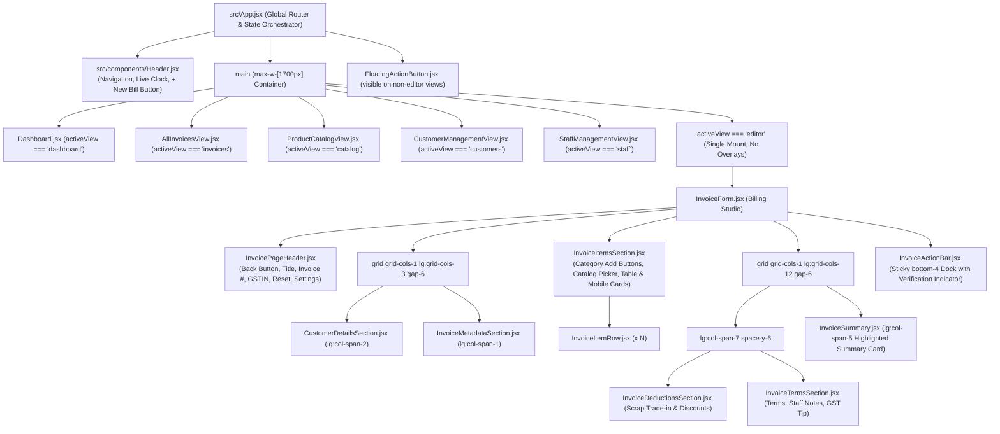

# Deliverable 4: Component Architecture & State Orchestration

**Phase:** Phase 2 — Complete Tax Bill Generator Replacement  
**Project:** TPS BATTERY HOUSE — GST Billing & Invoice Management System  
**Date:** November 2026  
**File:** `docs/audit/invoice-screen-replacement/COMPONENT_ARCHITECTURE.md`

---

## 1. Active Application Hierarchy

---

## 2. State Invariants & Props Contract

1. **`onNewInvoice` Contract:**
   All entry points (`Header`, `Dashboard`, `AllInvoicesView`, `FloatingActionButton`) call `handleStartNewInvoice` which guarantees:
   - Fresh invoice template initialized with transactional numbering prefix (`TPS/2026-27/00X`).
   - `activeView` transitions immediately to `'editor'`.
   - `editorMode` defaults to `'edit'`.
   - Zero modals mounted.

2. **`onReset` Contract:**
   Invoking "Reset Form" calls `handleResetInvoice`, which prompts with native confirmation alert, clearing only in-progress form inputs without modifying any saved Firestore records.

3. **Authoritative Financial State:**
   Calculated totals (`calculateInvoiceTotals(invoice, business.stateCode)`) are computed once at the `InvoiceForm` root and passed down to `InvoiceSummary` and `InvoiceActionBar`.

