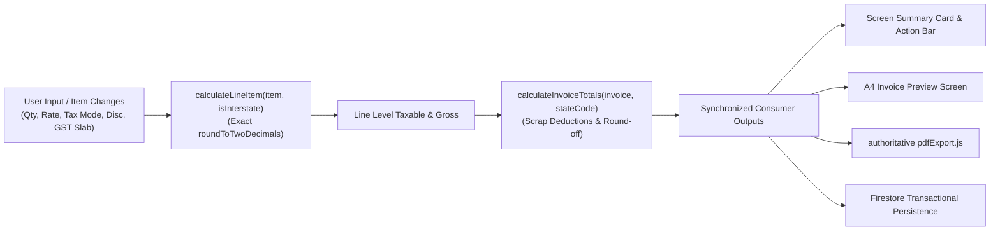

# Deliverable 5: Financial Integrity & Calculation Engine Verification

**Phase:** Phase 2 — Complete Tax Bill Generator Replacement  
**Project:** TPS BATTERY HOUSE — GST Billing & Invoice Management System  
**Date:** November 2026  
**File:** `docs/audit/invoice-screen-replacement/FINANCIAL_INTEGRITY_REVIEW.md`

---

## 1. Statutory Alignment & Single Source of Truth

The new full-page billing interface strictly routes all monetary figures through `src/utils/gstCalculations.js` and `src/utils/categories.js`. No calculations are performed inside presentation components.

---

## 2. Order of Financial Operations

1. **Gross Item Subtotal:**
   $$\text{Gross Total} = \sum \text{Line Total}$$
2. **Item-Level Discounts:**
   Deducted before tax calculation in tax-exclusive mode, or subtracted from inclusive MRP before tax reverse-derivation in tax-inclusive mode.
3. **Scrap Battery Buyback Deduction:**
   Subtracted from invoice subtotal after line item taxes are computed.
4. **Special Additional Discount:**
   Subtracted from subtotal after scrap buyback.
5. **Statutory Tax Application:**
   - **Intrastate (Kerala 32 $\rightarrow$ Kerala 32):**
     $$\text{CGST} = \text{roundToTwoDecimals}\left(\frac{\text{Total Tax}}{2}\right), \quad \text{SGST} = \text{roundToTwoDecimals}\left(\frac{\text{Total Tax}}{2}\right)$$
   - **Interstate (Kerala 32 $\rightarrow$ Other State):**
     $$\text{IGST} = \text{roundToTwoDecimals}(\text{Total Tax})$$
6. **Round-Off:**
   Automatic rounding to nearest integer with 2-decimal residual delta, or manual override within $\pm ₹500$ bounds.
7. **Final Payable Amount:**
   Displayed in bold amber font (`font-mono text-3xl text-amber-400 font-black`) matching Indian currency formatting.

