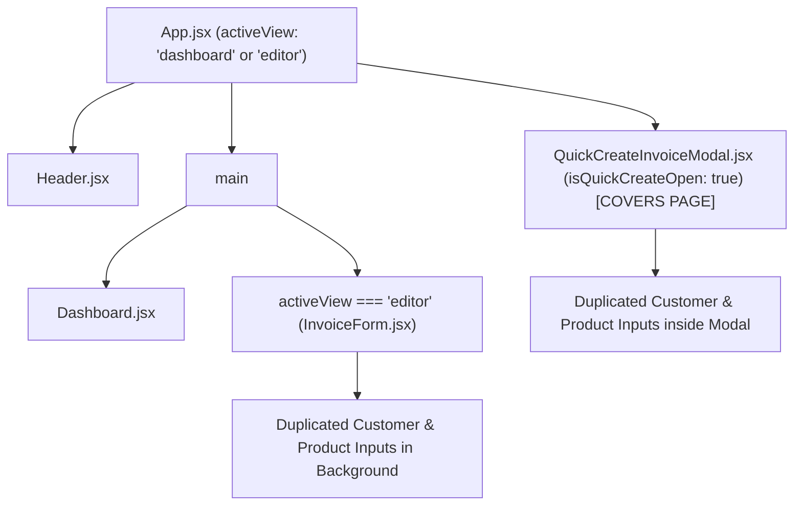
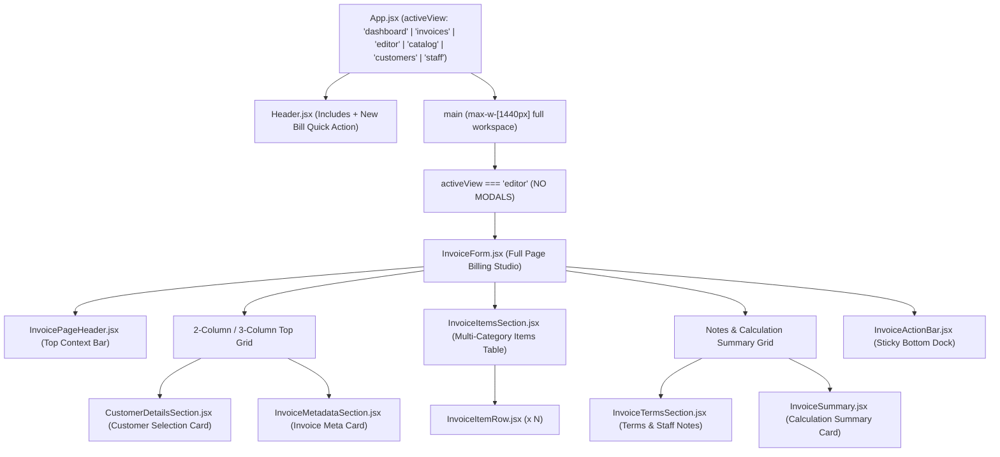

# Runtime Render Trace & Component Hierarchy Audit

**Phase:** Phase 2 — Complete Tax Bill Generator Replacement  
**Project:** TPS BATTERY HOUSE — GST Billing & Invoice Management System  
**Date:** November 2026  
**File:** `docs/audit/invoice-screen-replacement/RUNTIME_RENDER_TRACE.md`

---

## 1. Executive Summary: Why the UI Did Not Change

Our runtime-to-source inspection revealed the exact reason why localhost continued to display the narrow `Quick Create Multi-Category Invoice` modal and duplicated form content:

1. **Modal Interception in `handleStartNewInvoice` (`src/App.jsx:281`):**
   Whenever a user clicked `+ New Invoice` on the Dashboard, `+ New Invoice` in the All Invoices view, or the Floating Action Button, `handleStartNewInvoice` executed:
   ```javascript
   setInvoice(freshInvoice);
   setIsQuickCreateOpen(true); // <--- OPENED MODAL INSTEAD OF ROUTING TO EDITOR
   ```
   Instead of setting `setActiveView('editor')` to navigate to the full-page Tax Bill Generator studio, it opened `QuickCreateInvoiceModal.jsx` (`isQuickCreateOpen: true`).

2. **Duplicated Content Cause:**
   `QuickCreateInvoiceModal` was rendered as a modal overlay (`fixed inset-0 z-50 ... bg-slate-950/85 backdrop-blur-sm`).
   When `activeView === 'editor'` was already active (or opened via "Open in Full Studio"), or when "Reset Form" was clicked from inside the editor (calling `handleStartNewInvoice`), `isQuickCreateOpen` became `true`.
   Consequently:
   - The semi-transparent `QuickCreateInvoiceModal` was mounted in the foreground.
   - The full-page `InvoiceForm` was mounted directly in the background.
   - The user saw duplicated customer inputs, duplicated invoice metadata, and duplicated line items.

3. **Competing Primary Creation Flow:**
   `QuickCreateInvoiceModal.jsx` was acting as a primary creation interceptor on 4 distinct entry points, leaving the full-page billing studio obscured.

---

## 2. Complete Entry Point Trace

| Entry Point | Trigger Location | Handler Executed | Previous State Change | Intended Behavior |
| :--- | :--- | :--- | :--- | :--- |
| **Header Nav: Tax Bill Generator** | `src/components/Header.jsx:159` | `onClick={() => setActiveView('editor')}` | `activeView = 'editor'` | Full-page billing studio |
| **Dashboard: Hero `+ New Invoice`** | `src/components/Dashboard.jsx:182` | `onClick={onNewInvoice}` | `isQuickCreateOpen = true` *(BUG)* | `setActiveView('editor')` with fresh state |
| **Dashboard: Table `Create Invoice`** | `src/components/Dashboard.jsx:695` | `onClick={onNewInvoice}` | `isQuickCreateOpen = true` *(BUG)* | `setActiveView('editor')` with fresh state |
| **All Invoices: `New Invoice`** | `src/components/AllInvoicesView.jsx:192` | `onClick={onNewInvoice}` | `isQuickCreateOpen = true` *(BUG)* | `setActiveView('editor')` with fresh state |
| **Global Floating Action Button** | `src/components/FloatingActionButton.jsx:14` | `onClick={onClick}` | `isQuickCreateOpen = true` *(BUG)* | `setActiveView('editor')` with fresh state |
| **Invoice Header: `Reset Form`** | `src/components/invoice/InvoicePageHeader.jsx:54` | `onClick={onReset}` | `isQuickCreateOpen = true` *(BUG)* | In-place state reset with confirmation |

---

## 3. Previous vs New Component Hierarchy

### Previous (Buggy) Hierarchy


### New Authoritative Hierarchy


