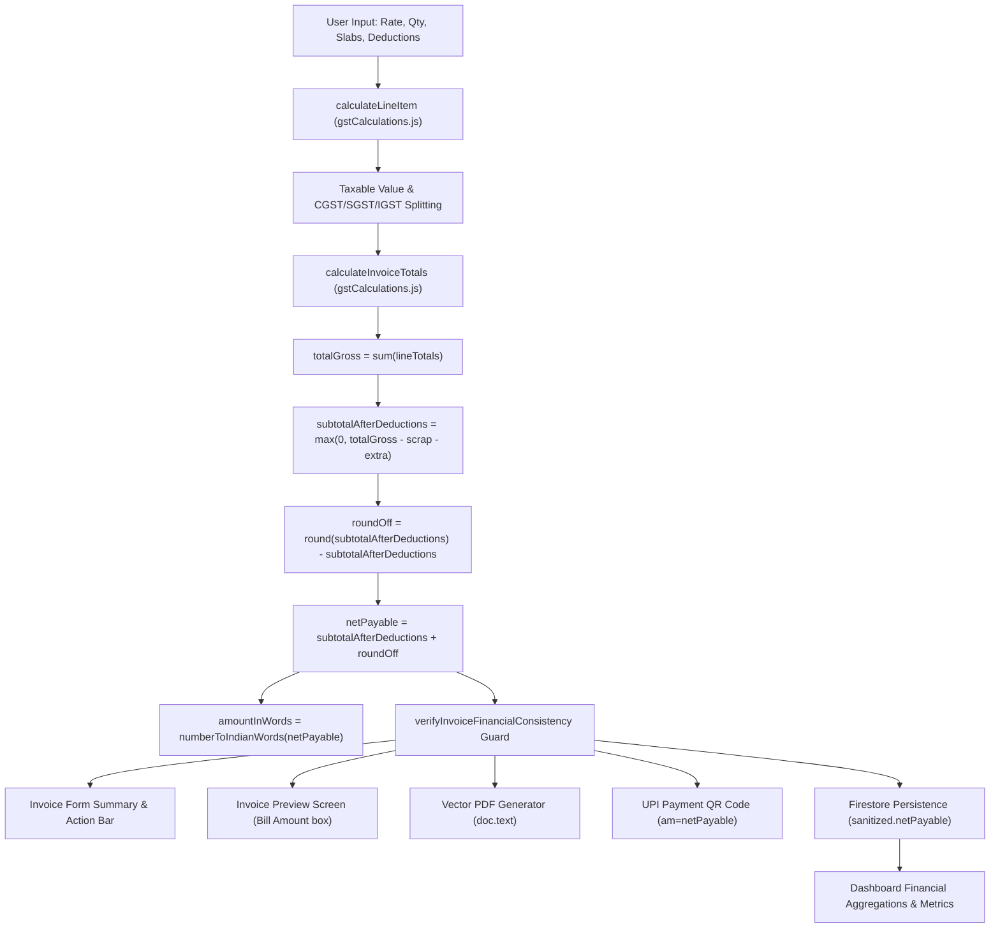

# END-TO-END FINANCIAL DATA FLOW AUDIT

**Project:** TPS BATTERY HOUSE — GST Billing & Invoice Management System  
**Auditor:** Principal Financial Software Engineer & Financial Data Integrity Auditor  
**Scope:** Lifecycle trace from user input to line calculation, tax splitting, deduction, round-off, persistence, preview, PDF, UPI QR, and dashboard aggregation.  

---

## 1. Complete Financial Data Flow Architecture

The application implements a centralized, deterministic financial calculation pipeline centered on `calculateInvoiceTotals` in `src/utils/gstCalculations.js`.

---

## 2. Granular Step-by-Step Data Transformations

### 1. Quantity & Price Input
- **Inputs:** `rate` (e.g. ₹11,562.50 or MRP ₹14,800.00), `qty` (e.g. 1.00), `isTaxInclusive` (boolean), `gstRate` (e.g. 28%).
- **Transformation:** Inputs are parsed via `validateFinancialInput`, bounded between `0` and `MAX_UNIT_PRICE` (₹10,000,000.00), and normalized via `normalizeInvoiceItem`.

### 2. Line Item Calculation (`calculateLineItem`)
- **GST-Inclusive Calculation:**
  $$\text{grossAmount} = \max(0, \text{rate} \times \text{qty} - \text{discount})$$
  $$\text{taxableValue} = \text{roundToTwoDecimals}\left(\frac{\text{grossAmount}}{1 + \frac{\text{gstRate}}{100}}\right)$$
  $$\text{totalGstAmount} = \text{roundToTwoDecimals}(\text{grossAmount} - \text{taxableValue})$$
  $$\text{lineTotal} = \text{grossAmount}$$
- **GST-Exclusive Calculation:**
  $$\text{taxableValue} = \max(0, \text{rate} \times \text{qty} - \text{discount})$$
  $$\text{totalGstAmount} = \text{roundToTwoDecimals}\left(\text{taxableValue} \times \frac{\text{gstRate}}{100}\right)$$
  $$\text{grossAmount} = \text{taxableValue} + \text{totalGstAmount}$$

### 3. Tax Component Splitting
- **Intrastate (Kerala $\to$ Kerala, State Code `32`):**
  $$\text{cgstRate} = \frac{\text{gstRate}}{2}, \quad \text{sgstRate} = \frac{\text{gstRate}}{2}, \quad \text{igstRate} = 0$$
  $$\text{cgstAmount} = \text{roundToTwoDecimals}\left(\frac{\text{totalGstAmount}}{2}\right)$$
  $$\text{sgstAmount} = \text{roundToTwoDecimals}(\text{totalGstAmount} - \text{cgstAmount})$$
- **Interstate (State Code $\neq$ `32`):**
  $$\text{igstRate} = \text{gstRate}, \quad \text{igstAmount} = \text{totalGstAmount}, \quad \text{cgst} = 0, \quad \text{sgst} = 0$$

### 4. Deductions: Scrap Buyback & Special Discount
- **Scrap Exchange:** Extracted from `invoice.scrapExchange.amount` when `enabled === true`.
- **Special Discount:** Extracted from `invoice.additionalDiscount`.
- **Deduction Processing:**
  $$\text{subtotalAfterDeductions} = \max(0, \text{totalGross} - \text{scrapDiscount} - \text{extraDiscount})$$

### 5. Round-Off & Final Net Payable
- **Auto Round-off:**
  $$\text{rounded} = \text{round}(\text{subtotalAfterDeductions})$$
  $$\text{roundOff} = \text{roundToTwoDecimals}(\text{rounded} - \text{subtotalAfterDeductions})$$
  $$\text{netPayable} = \text{rounded}$$
- **Manual Round-off (if provided):**
  $$\text{netPayable} = \max(0, \text{subtotalAfterDeductions} + \text{roundOffManual})$$

### 6. Amount in Words
- Generated strictly from `netPayable` via `numberToIndianWords(netPayable)`:
  $$\text{netPayable} = 13800.00 \implies \text{"Thirteen Thousand Eight Hundred Rupees Only"}$$

### 7. Preview & PDF Presentation Mapping
- Authoritative payable amount is bound directly to `totals.netPayable`.
- Stale or uninitialized `invoice.netPayable` (such as `0` from blank templates) is rejected by `verifyInvoiceFinancialConsistency` and synchronized.

### 8. Persistence & Storage
- `sanitizeInvoiceForFirestore` runs `verifyInvoiceFinancialConsistency` and persists `sanitized.netPayable = totals.netPayable`.
- Reopening the saved invoice evaluates the exact same `netPayable` with zero drift.

### 9. UPI Payment QR
- Encodes:
  $$\text{upi://pay?pa=9846830532@okaxis\&pn=TPS\%20BATTERYS\%20HOUSE\&am=13800.00\&cu=INR\&tn=Bill\%20TPS/2026-27/007}$$

### 10. Dashboard Aggregation
- Centralized `calculateDashboardMetrics` sums `inv.netPayable` across settled (`collectedRevenue`), pending (`pendingAmount`), and overdue (`overdueAmount`) categories.
