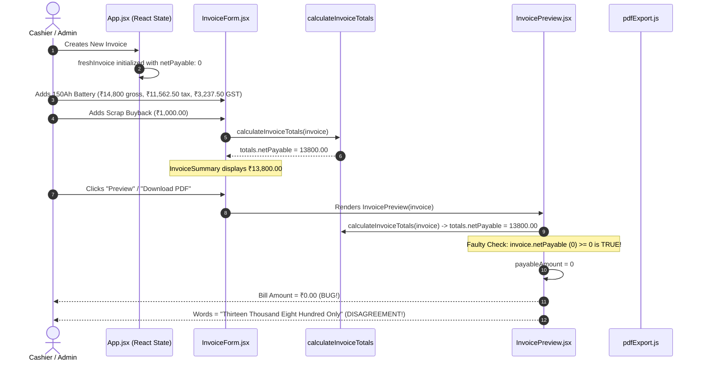

# ROOT CAUSE ANALYSIS — FINAL INVOICE AMOUNT DISPLAYING ₹0.00

**Project:** TPS BATTERY HOUSE — GST Billing & Invoice Management System  
**Defect Severity:** CRITICAL (Financial Inconsistency)  
**Reported Symptom:** In the invoice preview and printed bill, the numeric "BILL AMOUNT" displayed as `₹0.00` while "Amount in words" correctly displayed `"Thirteen Thousand Eight Hundred Only"`.  
**Resolution Status:** VERIFIED & RESOLVED  

---

## 1. Executive Summary

During previous audit refactoring (Commit `01c31c2b`), a defensive fallback pattern was introduced into both `InvoicePreview.jsx` and `pdfExport.js`:
```javascript
// PRE-FIX IMPLEMENTATION in InvoicePreview.jsx & pdfExport.js:
const totals = calculateInvoiceTotals(invoice, business?.stateCode || '32');
const payableAmount = typeof invoice?.netPayable === 'number' && invoice.netPayable >= 0
  ? invoice.netPayable
  : totals.netPayable;
```
The intention was to permit pre-computed `netPayable` values from stored records. However, this introduced a severe financial flaw:

1. When a new invoice draft is instantiated (`handleStartNewInvoice` in `src/App.jsx`), `freshInvoice` is created with `netPayable: 0`.
2. As the user enters line items and deductions in the invoice editor (`InvoiceForm.jsx`), React state holds `invoice.items` and `invoice.scrapExchange`, while `totals` is calculated on the fly by `calculateInvoiceTotals(invoice)`.
3. The raw `invoice.netPayable` property is NOT updated on every keystroke in `invoice` state. It remained `0` until explicitly saved.
4. When the user clicked "Preview Invoice", "Print Bill", or "Download PDF", `invoice.netPayable` was still `0`.
5. The ternary condition evaluated:
   ```javascript
   typeof 0 === 'number' && 0 >= 0 // -> TRUE!
   ```
6. Consequently, `payableAmount` was assigned `0`, completely discarding `totals.netPayable` (which was `₹13,800.00`).
7. Meanwhile, the statutory HSN tax table, scrap buyback row, round-off row, and Amount in Words were rendered directly from `totals` (`totals.amountInWords`).
8. This produced a glaring contradiction:
   - Line Total: `₹14,800.00`
   - Scrap Buyback: `-₹1,000.00`
   - Amount in Words: `Thirteen Thousand Eight Hundred Only`
   - **Bill Amount:** `₹0.00`

---

## 2. Technical Trace of the Defect



---

## 3. Secondary Vulnerabilities Identified & Eliminated

### A. Premature/Stale Firestore Persistence in `invoiceService.js`
In `src/firebase/services/invoiceService.js`, line 179 contained an identical ternary fallback:
```javascript
const netPayable = typeof rawInvoice.netPayable === 'number' && rawInvoice.netPayable >= 0
  ? Number(rawInvoice.netPayable)
  : totals.netPayable;
```
If an unsaved form state with `netPayable: 0` was serialized to Firestore, `invoiceService` would write `netPayable: 0` to the database, permanently poisoning the stored record.

### B. UPI Payment QR Discrepancy
In `src/utils/pdfExport.js` and `src/components/InvoicePreview.jsx`, `buildUpiUri` used `payableAmount`. When `payableAmount` evaluated to `0`, the QR code rendered with `am=0.00`, allowing customers to pay ₹0.00 for a ₹13,800.00 purchase.

### C. Absence of Pre-Issuance Consistency Guard
No validation layer checked whether an invoice with billable items (`totalGross > 0`) was attempting to issue or preview with `netPayable = 0`.

---

## 4. Root Cause Conclusion

The defect was not a mathematical error in `calculateLineItem` or `calculateInvoiceTotals`. The core engine computed ₹11,562.50 taxable, ₹3,237.50 GST, ₹14,800.00 gross, and ₹13,800.00 net payable flawlessly.

The defect was entirely an architectural state-mapping bug where an un-updated state property (`invoice.netPayable = 0`) was allowed to shadow and override the authoritative calculation result in downstream presentation and serialization layers.
