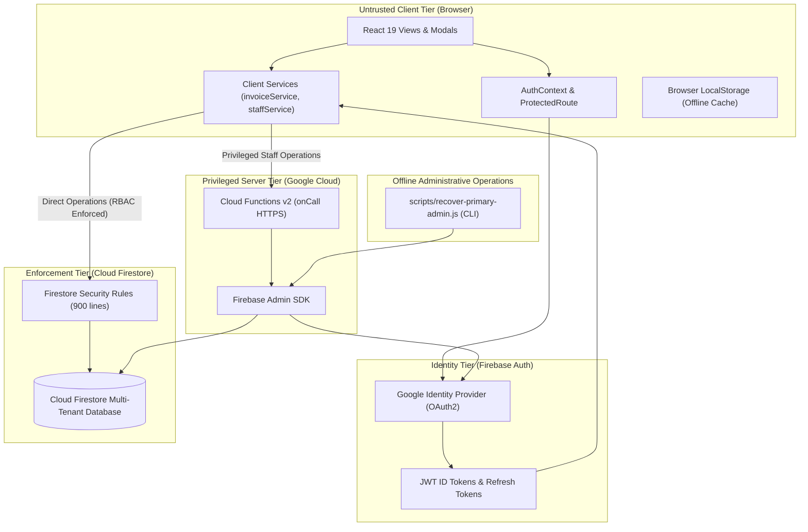

# TPS Battery House — Trust Boundary & System Architecture

## Architecture Overview
The TPS Battery House GST Billing application adopts a multi-tiered security model where each subsystem enforces strict operational boundaries. Filenames and client-side modules are never assumed to represent trusted server boundaries.

---

## Trust Boundary Classifications

### 1. Browser / Client Environment (Untrusted)
- **Components:** React components, custom hooks, `src/firebase/services/` client implementations, LocalStorage.
- **Trust Level:** **Zero Trust**. The browser environment can be inspected, manipulated, or bypassed by an attacker using custom scripts or network proxies.
- **Enforced Constraints:**
  - Client code NEVER holds Admin SDK credentials.
  - Client state or LocalStorage data is NEVER treated as authorization.
  - All direct Firestore operations are validated against security rules on the server.
  - Privileged staff operations (role assignment, status modification, approval, removal, UID migration) are delegated to Cloud Functions.

### 2. Firebase Authentication (Identity Provider)
- **Components:** Google Sign-In, Firebase Auth user accounts, JWT ID tokens.
- **Trust Level:** **Trusted for Authentication, Untrusted for Authorization**.
- **Enforced Constraints:**
  - Firebase Auth proves *who* the user is (`uid`, `email`).
  - Firebase Auth does NOT determine *what* the user is allowed to do in TPS Battery House.
  - Business authorization is governed strictly by Firestore membership documents: `businesses/{businessId}/members/{uid}`.
  - Refresh token revocation via `adminAuth.revokeRefreshTokens(uid)` prevents minting new ID tokens, while Firestore rules immediately cut off database access (<10ms) by verifying `isActiveMember(businessId)`.

### 3. Cloud Firestore Security Rules (Authorization Gateway)
- **Components:** `firestore.rules`.
- **Trust Level:** **Fully Trusted Enforcement Engine**.
- **Enforced Constraints:**
  - Evaluated atomically on every client request by Google Cloud.
  - Enforces tenant isolation (`businesses/{businessId}/...`).
  - Enforces role-based permissions (`admin`, `manager`, `cashier`).
  - Enforces document schema constraints, key count caps, string length bounds, and immutable snapshots.
  - Blocks all client writes to `/settings/admin_config` and `/invoice_numbers/{safeNumber}`.

### 4. Firebase Cloud Functions v2 (Trusted Backend Tier)
- **Components:** `functions/index.js` running on Node.js runtime.
- **Trust Level:** **Fully Trusted Server Environment**.
- **Enforced Constraints:**
  - Runs with privileged Firebase Admin SDK access.
  - Validates `request.auth` and requires the caller to be an active Administrator (`assertCallerIsAdmin`).
  - Serializes active administrator mutations with `admin_guard` OCC locking.
  - Verifies migration destination accounts directly with `adminAuth.getUser(newUid)`.
  - Automatically revokes refresh tokens when staff members are disabled or removed.
  - Writes server-timestamped audit records (`FieldValue.serverTimestamp()`).

### 5. Offline Administrative Operations (Isolated Server Tooling)
- **Components:** [`scripts/recover-primary-admin.js`](file:///home/navaneeth/Documents/Amal/scripts/recover-primary-admin.js).
- **Trust Level:** **Trusted Out-of-Band Operations**.
- **Enforced Constraints:**
  - Excluded from the frontend repository and Vite build tree.
  - Requires explicit CLI confirmation (`--confirm`) and operator attribution.
  - Verifies project ID and active administrator status before performing updates.

