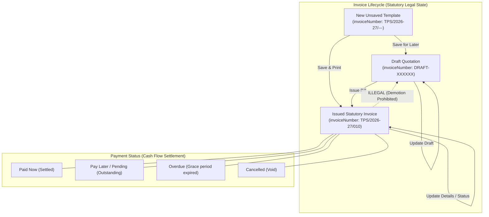

# Invoice Lifecycle vs Payment Status Architecture

**Project:** TPS BATTERY HOUSE — GST Billing & Invoice Management  
**Scope:** Domain Model, Lifecycle States, and Financial Integrity  
**Date:** 2026-11-12

---

## 1. Separation of Concerns

Invoice Lifecycle and Payment Status represent two distinct business dimensions:

---

## 2. Definitive Classification Matrix

| Document State | `invoiceNumber` | `paymentStatus` | Classification | Save for Later Action |
|---|---|---|---|---|
| Fresh Template | `TPS/2026-27/---` | `Paid` or `Pending` | **Case C: New Unsaved Invoice** | Saves as provisional Draft (`DRAFT-XXXXXX`, `paymentStatus: 'Draft'`). |
| Saved Draft | `DRAFT-123456` | `Draft` | **Case A: Existing Draft** | Updates existing draft without counter consumption. |
| Statutory Bill | `TPS/2026-27/010` | `Paid` | **Case B: Issued Invoice** | Updates existing invoice, keeping original number and doc ID. |
| Statutory Bill | `TPS/2026-27/010` | `Pending` | **Case B: Issued Invoice** | Updates existing invoice, keeping original number and doc ID. |

---

## 3. Financial Integrity & Reconciled Metrics

When transitioning an issued invoice from **Paid** to **Pending**:

1. **Total Billed:** Unchanged (`totalBilled = sum of all issued invoices`).
2. **Collected Revenue:** Decreases by `netPayable` (`collectedRevenue = sum of Paid invoices`).
3. **Pending Balance:** Increases by `netPayable` (`pendingAmount = sum of Pending invoices`).
4. **Total Outstanding:** Increases by `netPayable` (`totalOutstanding = pendingAmount + overdueAmount`).
5. **Collection Rate:** Recalculated dynamically (`(collectedRevenue / totalBilled) * 100`).
6. **Print & PDF Layout:** Marked as Credit/Pending with payment mode noted.
7. **Audit Record:** `updatedAt` and `updatedBy` are recorded on the invoice document in Firestore.

