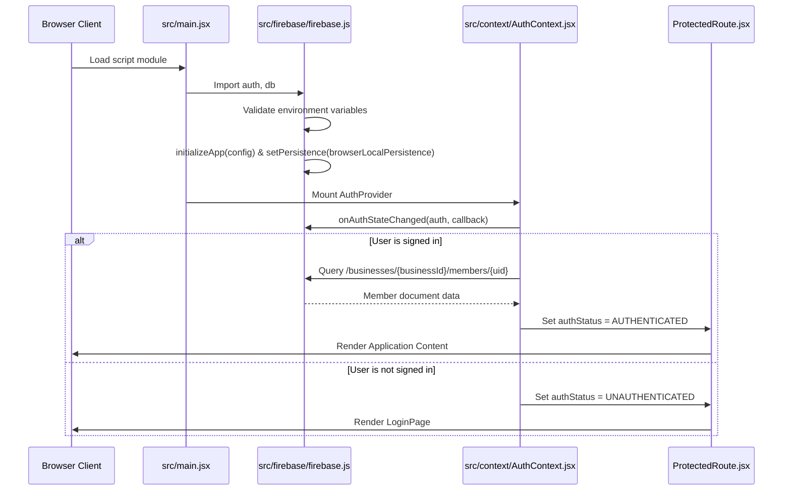

# Authentication & Firebase Initialization Review

**Project:** TPS BATTERY HOUSE — GST Billing & Invoice Management  
**Scope:** Firebase Initialization, Auth State Lifecycle, and Timeout Guards  
**Date:** 2026-11-11

---

## 1. Firebase Initialization Flow

### Architecture (`src/firebase/firebase.js`)


---

## 2. Hardened Initialization Fallbacks

### A. Environment Variable Validation
In `src/firebase/firebase.js`, environment variables (`VITE_FIREBASE_API_KEY`, `VITE_FIREBASE_AUTH_DOMAIN`, etc.) are validated at module import. If any are missing, an error is thrown.
- **Old Behavior:** If variables were missing, the browser threw an unhandled error, leaving a blank white screen.
- **Hardened Behavior:** The inline script listener in `index.html` intercepts any module evaluation failures and replaces `#pre-mount-fallback` with an informative error banner stating the missing configurations.

### B. Indefinite Loading Protection (`ProtectedRoute.jsx`)
In `src/components/auth/ProtectedRoute.jsx`:
- When `authStatus === AUTH_STATUS.LOADING` or `authStatus === AUTH_STATUS.CHECKING_AUTHORIZATION`, the system displays a branded loading screen with a spinner.
- **Watchdog Implementation:** Added a 7,000ms (7-second) timer watchdog.
  ```javascript
  useEffect(() => {
    if (
      authStatus !== AUTH_STATUS.LOADING &&
      authStatus !== AUTH_STATUS.CHECKING_AUTHORIZATION
    ) {
      return;
    }

    const timer = setTimeout(() => {
      setIsTimedOut(true);
    }, 7000);

    return () => {
      clearTimeout(timer);
      setIsTimedOut(false);
    };
  }, [authStatus]);
  ```
- If network latency or blocked websockets delay auth resolution past 7 seconds, a recovery card animates into view offering:
  1. **"Retry Verification"**: Re-triggers membership lookup or refreshes the page.
  2. **"Sign In with Different Account"**: Signs out the current user session so an administrator or cashier can log in with a clean credential.

---

## 3. Session Persistence & Security Alignment

1. **`browserLocalPersistence`:** Configured on the Firebase Auth client to ensure page refreshes do not drop the staff session or force repetitive logins.
2. **Strict RBAC Preservation:** No authentication or membership checks were removed or bypassed. All roles (`admin`, `manager`, `cashier`) and active/disabled statuses are validated against Cloud Firestore security rules.

